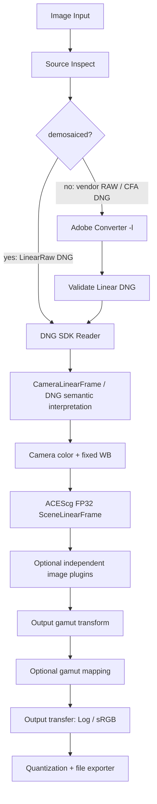
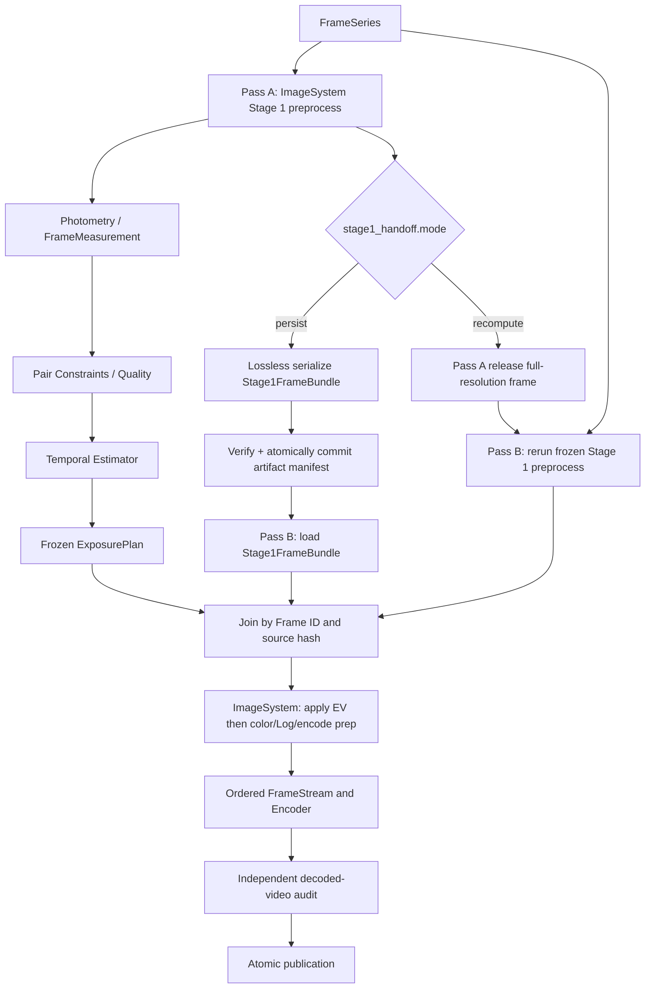

# raw-timelapse 架构与插件实施任务书 v2.6 — 生命周期与事件一致性修订 + 双系统 + Rust/C++

> **状态：目标架构与可执行迁移任务，尚未在 GitHub 仓库实施或提交。**  
> 日期：2026-11-07  
> 仓库：https://github.com/iBobbyTS/raw-timelapse  
> 代码审查基线：`main@f6d3ae789c6df9c3043c6f23e4400136d44ff0f3`  
> 运行平台：macOS Apple Silicon、Windows x86-64 + NVIDIA；本地离线。  
> **继承 v2.4 的全部功能与边界**：八种传输载体、插件 Schema、单图/序列双系统、严格 Adobe Converter/DNG SDK 路由、ACEScg FP32、V4 去闪语义、官方 Log 预设、可替换 CPU/Metal/CUDA。  
> **本版审计修订**：保留 v2.5 的全部能力，补齐 EventScope、RootRun 与子图调用的事件隔离、明确 ExposureApply、Stage1Bundle/FrameMeasurement Schema、Artifact 生命周期、未来消费者保留、事务事件 Outbox、渲染完成后的缓存释放与恢复语义。默认仍是 **Sequence RenderCompleted → Converter 逻辑节点请求释放临时 DNG → Rust ArtifactManager 安全清理**。

## 使用优先级和文档边界

本文件是**完整、规范性架构文档**，不是仅有 Rust 差异的补丁。实施冲突按本文件 > `docs/exposure-contract.md` 的较新 V4 条款 > 旧 v2.5 示例处理；**不能**将早期 V2 的场景分段语义重新带回现有算法。Stage 1 双模式的规范性要求见 §1.2 与 §7.1；事件执行及 Converter 清理的规范要求见 §4.4、§7.3–§7.6；任何早期示意图与双模式或事件规范冲突，以上述规范性章节为准。代码实现时，实测行为优先于对第三方 SDK 的猜测；不明确的语义要拒绝、标记 `UNVERIFIED` 或通过受控试验解决。

## 0. 架构决议和不可违反约束

1. **语言分工：Rust（safe-first）为主系统；C++20 为必要的原生计算与 SDK 层。** `rawtl` CLI、插件管理、图编译、双系统运行时、缓存、版本锁定、资源生命周期、调度、序列状态和非图像密集型去闪求解优先 Rust。Adobe DNG SDK、OpenColorIO、Halide、特定 Metal/CUDA kernel 使用 C++20/对应 GPU 语言。**Python 不是正式运行时依赖**，仅保留黄金测试与研究脚本。
2. **双系统独立**：`ImageSystem` 与 `SequenceSystem` 分别拥有图规范、图编译器、执行器、插件生命周期和对外 API；只共享底层 Rust contracts、插件 ABI、registry、allocator/device/artifact、公共图规划工具。Sequence 可以通过已发布的 `ImageGraph` API 运行子图，绝不能实例化 Image 的业务插件实现对象。
3. **开放的插件编程语言，统一二进制契约**：官方和第三方模块可由 Rust `cdylib`、C++20 `.dylib/.dll` 或其他可实现规定 C ABI 的语言编写。插件可单独编译/安装/更新/回滚，**无需重编宿主**。内部纯 Rust 的稳定宿主组件可静态编进 core，但**可替换的业务阶段必须像第三方插件一样经过统一的 contract/registry**。
4. **图是可配置、可校验的有类型 DAG**：任意兼容端口插入新模块、替换现有模块；不兼容数据必须通过显式适配器，不能隐式转换颜色、黑电平、内存位置、图像尺寸或临时落盘；图版本固定且任务运行中不替换。
5. **严格 RAW 路由**：已经去马赛克、受支持的 `LinearRaw DNG` → Adobe DNG SDK；CFA DNG 及白名单厂商 Mosaic RAW → Adobe DNG Converter `-l` → 验证 LinearRaw DNG → DNG SDK。按用户指定假设两者支持情况相同；失败直接报错、没有 LibRaw、其他 converter 或 SDK fallback；不能将原始 CR3 直接交给 DNG SDK。
6. **当前 DNG 的黑/白电平和线性化解释归 SDK adapter**，不得再次使用原始厂商 RAW 的黑电平数值扣减。Adobe/DxO 已去马赛克 DNG 只有**接口语义兼容**，不能当作像素或画质相同。Stage3 不等于必然无负值裁切，需按真实 SDK 输出检验。
7. **Color 管线：Camera Linear → 明确的相机颜色解释与白平衡 → XYZ/必要色适应 → ACEScg AP1/D60 FP32**，不暗中应用显示曲线、per-frame AutoWB/AutoBright 或隐式裁切。目标色域矩阵、可选 gamut mapping、Log/显示 OETF、量化、编码相互独立。
8. **曝光行为冻结**：当前 V4 单一按文件名排序序列，不依据 scene cuts 自动拆分；matched-background pair-graph、smooth/uniform、显式 steps、quality/review、frozen target、RenderAttempt、实际编码视频独立审计。移植 Python 算法到 Rust 时保持可复现的算法语义，数值误差需说明。
9. **内存安全责任**：Rust 的安全仅保护 Rust 安全代码。被同进程加载的 C/C++ 插件仍可越界、破坏堆内存或终止宿主；第三方/高风险插件须可配置 `worker-process`，用进程隔离降低故障影响。共享 Rust/C++ 边界保持最小 `unsafe` 和明确的所有权/同步协议。
10. **CPU 是功能基准**。图像像素操作可选 Halide CPU/Metal/CUDA，必要时原生 Metal/CUDA；稀疏曝光图求解先用 Rust 实现并按实际基准决定是否换数学后端。任何设备路径都遵循同一颜色/图像/曝光契约。
11. **构建/执行相互独立**：Cargo 构建 Rust 宿主和 Rust 插件，CMake 构建 C++ SDK/计算插件；安装插件时校验 ABI/Schema/签名或 hash；图配置变更只重新编译*ExecutionPlan*；GPU 内核 AOT 优先，必要时 JIT 并缓存，绝不每帧 JIT。
12. **冻结与审计**：任务锁定 plugin exact version、二进制哈希、配置哈希、色彩 profile、输入 hash、图/内核版本；每帧缓存可重建；源文件不可变；最终产物在独立审计通过后原子发布。
13. **本版只完成设计文档**，所有新 CLI、插件宏、C ABI、图结构与目录均为拟实现目标；不得把示例当成现有程序已经支持的能力，也不因此自动授权修改 GitHub。
14. **首轮 Stage 1 交接双模式**：必须由用户/作业明确选择 `persist`（全精度 Stage 1 输出落盘后 Pass B 直接读）或 `recompute`（Pass A 不落盘该输出，仅计算分析特征；Pass B 使用冻结的相同 ImageGraph 重新预处理）。**不得**隐式混合两种路径，也不得用第一轮的曝光计划修改 Stage 1 自身的显影配置。
15. **事件驱动作为插件运行时一等能力**：任何获授权的节点可按声明发布/订阅有类型、版本化事件；事件可触发节点执行、受控资源释放、后续子图、取消或通知，但不可以绕过数据端口、任务依赖、阶段类型检查和安全权限。
16. **默认缓存释放协议**：由 Rust SequenceRuntime 在全部帧渲染成功并关闭上游资源、满足 consumer-liveness barrier 后发布 `rawtl.sequence.deflicker_render.completed@1`。Adobe Converter **逻辑控制节点**接收此事件，执行 `release_temporary_cache` 请求；仅 `ArtifactManager` 可按产物 owner、所有未来/活跃消费者、Pin 与租约安全执行删除。失败/取消只在系统达到 `QUIESCENT` 后做终止清理；不得误删源 DNG、其他任务或持久缓存。
17. **主调用与子图调用隔离**：顶层独立 ImageSystem 任务可按 `image.run.completed` 清理 Converter 临时 DNG；SequenceSystem 内的 ImageGraph 是 `sequence_child`，其完成事件**不能**触发独立单图缓存清理。
18. **统一持久状态**：Run/Attempt/Node/Artifact、Event Outbox/Inbox 与删除意图由 Rust 本地事务状态库记录；文件系统 rename、数据库事务和插件副作用必须经崩溃恢复对账，不得宣称存在跨文件系统/DB 的天然原子事务。

## 1. 两个系统及相互关系

### 1.1 ImageSystem（单张图像）

输入：一个 `DiskArtifact/MemoryFile` 图像源，加上参数及 `MetadataDoc`。输出可为 `SceneLinearFrame`、`ImageFrame`、`MemoryFile`、`DiskArtifact`，也可以产生多路输出。

典型默认图：



ImageSystem 必须能在没有 SequenceSystem 时独立：`image inspect`、`image run`、`image graph validate`。默认 `exposure.apply` 若未提供曝光计划，采用显式 `EV=0`；允许用户将独立曝光插件挂接到指定节点，不隐式执行去闪。

**插件接入**：修改 ImageGraph 配置，给每个插件提供符合契约的输入端口，声明新输出端口并连接下游。默认不自动插入有损适配器。图可分支为 EXR 母版与 Log 预览；各输出可以共享已完成的上游计算。

### 1.2 SequenceSystem（图像序列）

输入：顺序固定的 `FrameSeries`，内容为 ImageSystem 可读取的 `SourceRef`。序列的顺序、帧 ID、source hash、帧率/时间基由 SequenceManifest 约束；**不靠迭代器偶然顺序**。

**定义唯一的 Stage 1 交接点：** `ImageGraph.preprocess` 的 `stage1.bundle` 端口，输出 **`rawtl.stage1-frame-bundle@1`**（包含完整分辨率、ACEScg AP1/D60、FP32、尚未应用本轮去闪 EV 的 `scene_linear` 图像，以及全部必需 masks/metadata/provenance 的 typed port group）。**Stage 1 的最后一个节点由用户可插拔的处理图配置决定，但其输出必须满足该端口的固定类型契约。** 任何会影响这个端口的插件版本/参数，在同一个 run 的 Pass A/B 之间必须锁定。此交接点与 Adobe Converter 的 Linear DNG **不是同一种产物**。

序列默认图采用两个 Pass，**两种严格可选的数据交接模式**：



**`persist` 模式：** Pass A 每张图调用 Stage 1 一次；同一份未修改的 Stage 1 结果分别用于 `FrameMeasurement` 和无损缓存。先验证缓存写入，再将该帧标为可用于 Pass B。Pass B 只能通过 `stage1.cache.load` 从已提交的 Stage 1 artifact 读取**完整帧**，按 `frame_id/source_hash` 和 ExposurePlan 对齐，之后应用 EV 与输出变换；**不得再次调用 Converter、DNG SDK 或 Stage 1 插件**。缓存缺失/损坏/版本不兼容时失败，不悄悄转为重新处理；用户可显式另起一次 `recompute` 或 `cache rebuild` 作业。

**`recompute` 模式：** Pass A 使用 Stage 1 结果做首轮测量，保留 `FrameMeasurement`/必要序列统计后立即释放全分辨率 `SceneLinearFrame`；不保存这一 Stage 1 完整输出。Pass B 在生成并冻结 ExposurePlan 后，通过**相同 ImageGraph 精确版本、配置、RAW 来源和色彩标尺**对每张图重新执行 Stage 1，再应用对应 EV。不能在 Pass B 依照曝光校正结果自动调整 RAW 白平衡、BaselineExposure、黑位或其他 Stage 1 开发参数。

**两种模式共性：** `FrameMeasurement`、`PairConstraints`、`ExposurePlan` 与结果报告可以独立写入少量检查点；“不落盘”**专指完整 Stage 1 场景线性图像**，不禁止必要的运行元数据、曝光计划及 Adobe Converter 自身产生的 Linear DNG 临时/持久缓存（Converter 本身要求文件输出）。更改任何 Stage 1 上游节点必须触发完整缓存失效或重算。`persist` 不代表跳过 Pass A 的分析，也不允许把已经应用 EV、映射到 Log 的图像存入 Stage 1 缓存。

SequenceSystem 不直接实例化 Adobe SDK 或 Log 模块的 C++ 类，而是通过**ImageGraph 的公开 API**执行 `preprocess` 子图、`analysis` 子图与 `render_after_ev` 子图。调用上下文须包含 `invocation=sequence_child` 与 `root_run_id`；子 ImageGraph 仅发出可观测的 subgraph 完成事件，不产生会误释放 Converter 的顶层 `image.run.completed`。去闪估计器仅接收 `FrameMeasurement / PairConstraints`，只输出 `ExposurePlan`；曝光应用节点仅读计划、不调用估计器。阶段切分必须在图编译时可见。

**插件接入**：可在 Stage 1 之前插入任意兼容的图像插件、替换 Stage 1 子图节点，也可更换测量/帧间配对/时间估计/渲染/编码/审计节点。新模块若改变 Stage 1 输出，必须刷新缓存 fingerprint；跨帧状态只能放在 SequenceGraph，不应偷偷藏在普通单帧插件里。

**独立生命周期**：ImageSystem 编译单帧 DAG；SequenceSystem 编译序列 DAG 并引用已编译的 ImageGraph 子计划。两套系统分别安装、验证、运行和升级。SequenceSystem 只依赖 `stage1.bundle` 以及 `FrameMeasurement` 等发布的契约，不绑定 ImageGraph 内部算法实现。

## 2. 插件的固定输入/输出类型——规范性定义

### 2.1 两层类型系统

**传输载体（Transport Kind）**是全平台固定的少量类型；**语义 Schema（Semantic Type）**在其上进行精确约束，允许新增而不用每次改 ABI。

| 固定传输类型 | 必须携带内容 | 典型用途 | 重要约束 |
| --- | --- | --- | --- |
| **`DiskArtifact`** | `artifact_id`, sandbox 内文件 URI/相对路径、大小、media_type、hash、只读权限、生命周期 | CR3、DNG、EXR、MP4、报告文件 | 插件不能任意访问宿主全盘；由 host 授予只读路径或写入临时 artifact 权限；成品需 commit |
| **`MemoryFile`** | `ByteBufferHandle`、有效字节长度、MIME/格式、只读性、hash（可延后计算） | 内存中的 DNG、PNG、压缩图片、JSON/CBOR | 代表**编码后的文件内容**，不是已解码像素；不需要必须落盘；适配器可以显式 materialize |
| **`NDArray`** | `BufferHandle`、dtype、shape、strides、offset、布局、endian、device、read-only、同步事件 | RGB/深度/掩码/亮度/数值向量 | 只是数值容器，不自动具有颜色或曝光语义；限制秩和尺寸、校验越界 |
| **`RecordTable`** | 版本化列式表 schema + columns（可由 NDArray/strings/null bitmap 组成） | tile 亮度、帧间约束、统计、报告数据 | 允许 Arrow C Data 互操作，但宿主 ABI 不强制安装 Arrow runtime |
| **`MetadataDoc`** | `schema_id`, `schema_version`, typed fields, provenance | DNG 元数据、曝光标尺、颜色 profile、质量证据 | 可以作为数据附带信息，也可以作为**元数据专用输出端口**；不可由插件无权限覆盖核心字段 |
| **`ScalarValue`** | bool/int/float/UTF-8/enum/结构化参数，单位/边界 | EV、帧率、quality-policy、开关、阈值 | 构建图时优先确定常量；动态值仍需端口校验 |
| **`FrameSeries`** | sequence ID、有序的 `FrameRef[]`、timebase/fps、source refs、不可变 manifest | 图像序列输入、帧选择 | **不是装满所有像素的 vector**；避免长序列整体驻留 RAM |
| **`FrameStream`** | 类型化 stream handle、背压窗口、帧 ID/PTS、取消/EOF、错误通道 | Pass A/B 输出、编码、实时消费 | 一次消费 / 生命周期独立；流不是通用文件，也不是无边界队列 |

**没有将 `ImageFrame`、`Mask`、`ExposurePlan` 简化为 `any NDArray`**：它们作为语义类型（下一节）进行强校验和静态连线。除上述载体外，插件调用还需有**控制面类型**：`Status/Error`、`CapabilitySet`、`CancellationToken`、`ProgressEvent`、`SyncFence` 和 `ResourceBudget`，这些不是任意数据端口的载荷，不得用普通 Metadata 偷渡错误和生命周期控制。**`EventEnvelope` 属于新增的独立控制面类型，不是第九种数据传输载体；事件 payload 允许携带对上述载体的只读引用，但必须经权限/租约验证。**

### 2.2 预置语义 Schema（内建不可删除、可扩展）

| 语义类型 ID（示例） | 载体 | 约束与使用位置 |
| --- | --- | --- |
| `rawtl.source-ref@1` | DiskArtifact + MetadataDoc | 源格式、真实 RAW IFD、相机/帧身份、source hash |
| `rawtl.linear-dng@1` | DiskArtifact / MemoryFile | 验证后的 LinearRaw DNG；`PhotometricInterpretation=34892` 与可处理多色平面 |
| `rawtl.camera-linear-frame@1` | NDArray + MetadataDoc | FP32，Camera Linear RGB、原生通道、当前 DNG 的黑白电平/Opcode 处理状态、白平衡/颜色矩阵和裁切证据 |
| `rawtl.scene-linear-frame@1` | NDArray + MetadataDoc | FP32 RGB；ACEScg/AP1/D60/linear；光度归一化；允许负值及 >1 |
| `rawtl.stage1-frame-bundle@1` | **Typed port group**（运行时由 `NDArray` + masks + `MetadataDoc` 构成；持久化由 `DiskArtifact` + manifest 构成） | 唯一 Stage1 边界：完整 `scene_linear`、辅助 mask、空间/色彩/曝光标尺、source/frame ID、provenance；无本轮去闪 EV。Port group 不增加第九种 Transport |
| `rawtl.stage1-artifact-manifest@1` | MetadataDoc / DiskArtifact | 单帧完整性校验、EXR/sidecar 引用、缓存指纹、数据版本、所有权、校验状态 |
| `rawtl.image-frame@1` | NDArray + MetadataDoc | 明确颜色原色、白点、OETF/Log、全/有限范围、图像方向、alpha 等；严禁与 Camera/SceneLinear 自动混用 |
| `rawtl.mask@1` | NDArray + MetadataDoc | boolean/uint8/float，空间坐标系、有效范围、像素对齐规则 |
| `rawtl.frame-measurement@1` | RecordTable + MetadataDoc | **冻结 V4 字段**：`frame_id`, `log_luminance[K]`, `valid[K]`, `centers[K,2]`, `saturation_fraction[K]`, `log_pixel_samples[K,P]?`, `log_channel_means[K,3]?`, `sample_grid_descriptor`, `saturation_mask_quality`, `quantum_linear`, `measurement_profile_hash`；各 Tile 和采样索引可对齐 |
| `rawtl.pair-constraints@1` | RecordTable | frame pair、匹配质量、相对 EV、权重/状态；不带图片或 RAW SDK 对象 |
| `rawtl.exposure-plan@1` | RecordTable + MetadataDoc | frozen `requested/applied/render_ev`、状态、目标、证据、算法配置哈希、帧 ID |
| `rawtl.output-profile@1` | MetadataDoc | target gamut/white、transfer、range、YCbCr matrix、量化规则、输出容器/标签策略 |
| `rawtl.sequence-manifest@1` | FrameSeries + MetadataDoc | 全序列稳定排序、统一参数、帧率、source continuity、文件身份 |
| `rawtl.video-artifact@1` | DiskArtifact + MetadataDoc | 文件、bitstream tags、codec、timebase、color profile/provenance |
| `rawtl.audit-report@1` | MetadataDoc / DiskArtifact | 编码后独立时序/色彩审计、错误状态、不可测的边界条件 |

语义类型本身使用稳定 `schema_id@major`；增加不破坏意义的字段可扩 minor schema，破坏性改变发布新的 major。插件可声明自己的类型，如 `com.vendor.edge-map@1`（基于 NDArray），但必须在注册时提供机器可验证的 schema 与校验器；不能修改内建契约以适应单个插件。

### 2.3 每个数据对象的公共 Envelope

```yaml
schema: rawtl.data-envelope@1
value_id: sha256-or-generated-id
transport_kind: NDArray
semantic_type: rawtl.scene-linear-frame@1
payload: <opaque host-managed handle>
metadata:
  schema_id: rawtl.scene-frame-metadata@1
  color_space: ACEScg
  transfer: linear
  white_point: D60
  exposure_scale_id: <explicit calibrated/assumed scale>
  clipped_upstream: unknown
  source_frame_id: 0042
provenance:
  producer: rawtl.camera-color
  implementation_version: 1.0.0
  configuration_hash: <sha256>
  source_hashes: [<sha256>]
  parent_value_ids: [<value_id>]
mutability: immutable
```

- **载荷与元数据同一个生命周期；元数据不丢失，也不允许插入图像节点时自行变为匿名数组。**
- `MetadataDoc` 除自身可作输出载荷外，应随其他数据对象附带；缺失必要字段时图编译或执行报错。
- 配置参数（用户指定的 EV、profile）与影像证据 metadata 区分；来源不同的元数据显式使用 `source.*`、`dng.*`、`color.*`、`exposure.*`、`audit.*` 命名空间。
- `MetadataPatch` 是受规则约束的写入操作，不可直接修改输入对象；新输出生成新 immutable Envelope 并记录 parent ID。

### 2.4 数组 / GPU 内存契约

`NDArray` 不以 NumPy、Eigen、Halide、Metal、CUDA 等第三方类型作为对外 ABI；采用 host 管理的不透明缓冲区。

必须可查询：`dtype`（UInt8/16、Int16/32、Float16/32/64、Bool）、`ndim/shape[]`、`byte_stride[]`、`offset`、`endianness`、`layout`（HWC/CHW、planar/interleaved）、`memory_domain`（Host/PinnedHost/Metal/CUDA）、`device_id`、`byte_length`、`alignment`、`read_only`、`sync_event`。

- 默认**只读借用**；写入须由 host 分配新输出或显式取得独占 mutable view；不得在共享分支原地改写。
- 同设备、兼容布局时可以零拷贝；不同设备/格式必须出现一个**显式的** `device.transfer` 或 `array.relayout` 节点（可由图规划器建议，但默认需要用户/策略授权）。
- GPU 数据不得在同步完成前交给 CPU consumer；Metal/CUDA 同步由 runtime 的 fence/event API 负责。插件卸载/取消时必须处理在途 kernel 与缓冲资源，禁止悬空指针。
- 可选 DLPack (`DLManagedTensorVersioned`) 互操作用于外部数值库；它**不是正式插件公共 ABI 的唯一表示**。如使用，严格遵循 release/deleter 和跨 stream 同步约定。
- 表格式数据可选 Arrow C Data 交换，适合 frame measurements；也不应让核心 ABI 依赖 Arrow 的 C++ ABI。

### 2.5 DiskArtifact、MemoryFile 的具体区别

- `DiskArtifact` 是由 runtime 认证、权限受限的**磁盘产物引用**；Reader 可以选择 mmap 或流读取，无须一次加载全文件。缓存清理由 runtime 管理，运行中活跃引用不能被删。
- `MemoryFile` 是**完整或流式可读的编码文件内容**（如压缩的 TIFF/DNG），具有 content type；不是已解码 RGB 数组，也不表示 JSON 配置对象。`MemoryFile→DiskArtifact` 需要 `artifact.persist` 显式物化；`DiskArtifact→MemoryFile` 需要 `artifact.load` 并受内存预算限制。
- Adobe Converter 需要磁盘路径，因此如果上一阶段产生 `MemoryFile`，需在图中先放 `artifact.persist`；**不要让 Converter adapter 背后偷偷落盘**，否则缓存/审计/权限不可观察。
- DNG SDK 初期可按磁盘输入实现；未来如果具备内存流读取能力可以增加同一 plugin 的第二个输入能力，在 manifest 中声明，不改变公共 `rawtl.linear-dng@1` 语义。

### 2.6 数据类型与转换规则（必须可测试）

| 连接 | 是否直接兼容 | 解决方式 |
| --- | --- | --- |
| DiskArtifact(DNG) → AdobeConverter | 仅符合 `rawtl.source-ref@1` 与 `route=mosaic` 时 | 正常连接 |
| MemoryFile(DNG) → AdobeConverter | 否 | 插入显式 `artifact.persist` |
| DiskArtifact(Linear DNG) → DNG SDK | 符合 `rawtl.linear-dng@1` 时 | 正常连接 |
| DiskArtifact(DNG) → SceneLinearFrame | 否 | DNG SDK + camera-color 两个显式阶段 |
| NDArray(Float32 RGB) → SceneLinearFrame | 否 | `image.attach-color-semantics`，必须提供经过验证的颜色和曝光证据 |
| CameraLinearFrame → SceneLinearFrame | 否 | `color.camera-to-acescg` |
| SceneLinearFrame → Log ImageFrame | 否 | `output.gamut` → `output.transfer`，可选 mapping |
| Host NDArray → CUDA/Metal NDArray | 否（device 约束不匹配） | `device.transfer` 显式节点 |
| FrameSeries → FrameStream | 不能自动 | `sequence.map(image-graph)` 等有界 map 节点 |
| FrameStream → Video Artifact | 否 | `video.encoder` + `video.verify` |
| Stage1FrameBundle(NDArray) → Stage1FrameBundle(DiskArtifact) | 否 | `stage1.cache.persist`（显式且强制无损） |
| Stage1FrameBundle(DiskArtifact) → Stage1FrameBundle(NDArray) | 否 | `stage1.cache.load`（先校验哈希/Schema/颜色合同） |
| Stage1FrameBundle → FrameMeasurement | 否 | `analysis.photometry` 显式节点；绝不可自动把全帧当成测量结果 |
| MetadataDoc → ImageFrame | 否 | Metadata 本身不是像素数据 |

所有节点端口都声明 `transport_kind + semantic_type + schema_version_range + constraints + cardinality + streaming`。两个节点仅当**所有硬约束**满足时才能连线；绝不把格式转换的副作用隐含在文件名或 RGB 类型上。

### 2.7 事件 Envelope 与数据端口分离

- `rawtl.event-envelope@1` 只存在于控制平面，不改变固定的八种数据 Transport，也不能替代 typed data edge。强制字段：`event_id`, `event_type`, `schema_version`, `root_run_id`, `attempt_id`, `producer_kind` (`runtime|plugin`), `producer_id`, `scope` (**`node|image|frame|sequence|run|artifact`**), `subject_id`, `sequence_number`, `payload_schema`, `payload`, `run_lock_hash`, `causation_id?`, `timestamp`。可选 `graph_instance_id`, `node_instance_id`, `frame_id`, `sequence_id`。不得把 `scope` 当成插件执行进程身份。
- 事件可携带 `ArtifactId`、`FrameId`、状态、完成帧数、可控参数等**值或引用**；不传不透明 `RtValue*`、CPU 裸指针、CUDA/Metal handle，也不把未完成的图像帧嵌入事件 payload。
- 事件 ID 同一 root_run/attempt 内稳定；`run_lock_hash` 决定可用订阅/权限。运行时使用事务性 Event Outbox / Inbox 记录 `ready → delivered → acknowledged/failed`，与 Node/Artifact 的持久状态对账；`ACK` 是**控制动作已持久受理**，不等于物理删除已完成。详细语义见 §4.4 和 §7.4。

### 2.8 Rust/C++ 间的实际生命周期保证

- `BufferHandle`/`RtValue` 是 host 管理的**不透明整数 ID 或受控句柄**。C ABI 可以短暂借出 `const void*` 供当前 CPU 调用访问，插件不得把该裸指针跨调用、异步回调或卸载期保存。需要跨调用存活的引用必须经 `retain/release`，GPU 异步还必须经 fence 延长租期。
- Runtime 的 Rust 所有权只约束 host 代码，不会神奇修复 native 插件越界写、内存重解释、SDK 返回错误指针等行为。因此**共享内存视图、DMA/GPU API 和 FFI 实现处仍是明确的 `unsafe` 信任边界**。
- Host 校验数组大小、shape×strides 溢出、offset、对齐、设备域、权限和 fence 后再授权映射；插件只能修改分配给自己并持有独占写 lease 的输出 buffer。插件强制转换指针类型、越界写属于协议违规，不能靠 Rust 编译器防止。
- `MemoryFile` 和 `DiskArtifact` 不跨工作进程直接传 host 指针。Worker 使用文件描述符/只读共享内存 region + 元数据消息，或权限受控的文件引用；进程内可借用 `BufferHandle`。IPC 的大数组传输是否零拷贝属于实现优化，不是 ABI 保证。
- 元数据 envelope 与数据句柄以同一 immutable `value_id` 发布，生命周期分离时须明确引用关系；取消、失败、插件卸载、CUDA stream/Metal command completion 后由 runtime 有序回收。插件永远不调用 `free/delete` 回收 host 所有内存。

## 3. 插件 ABI、Rust/C++ 开发 SDK、安装与故障隔离

### 3.1 插件分类及统一业务契约

| 插件实现 | 编译形式 | 接入方式 | 建议用途 |
| --- | --- | --- | --- |
| Rust 官方/第三方业务插件 | Cargo `cdylib`（macOS `.dylib`, Windows `.dll`） | 由 Rust Plugin Host 按**C ABI** 动态加载，或者 Worker 协议 | source inspector、估计器、表数据转换、报告、graph 级任务 |
| C++20 官方/第三方业务插件 | CMake 共享库 | C ABI adapter，不暴露 C++ 对象、STL、Eigen、OCIO/Adobe 类型 | DNG SDK、OCIO、Halide kernels、设备专用算法 |
| 其他语言的插件 | 同样实现 C ABI 或 Worker 协议 | 明确表述兼容能力 | 后续扩展，默认不要求 host 内置其 VM |
| Rust host 基础设施 crate | Cargo 静态链接到宿主 | Rust 内部 API（非第三方插件） | 图编译、registry、artifact、buffer、权限、调度、安全包装 |
| 进程隔离插件 | 单独 Worker 可执行程序 + manifest | **Worker IPC Protocol**（同语义 Schema，不是直接调用共享库指针） | 不可信插件、实验性 RAW reader、可能崩溃的原生解码 |

**区别很重要**：Rust host 内部可以用 trait + `Arc` 组织运行时对象，但这不是可独立升级的第三方插件 ABI。可替换阶段必须实现注册的 Port Contract；进程内使用稳定 C ABI，Worker 通过序列化消息及共享内存遵守相同业务语义，不能声称 raw C 指针跨进程传递。

### 3.2 插件包（两平台独立产物，允许同一个插件版本多种实现）

```text
plugins/<vendor>/<name>/<semver>/
├── plugin.yaml                      # id、version、language、mode、ABI、ports、capabilities、permissions
├── lib/
│   ├── macos-arm64/<name>.dylib
│   └── windows-x86_64/<name>.dll
├── workers/                         # 可选 worker 可执行文件
├── kernels/                         # 可选 metallib、PTX/cubin、Halide AOT 产物
├── schemas/                         # 自定义 Semantic Types
├── fixtures/                        # 契约测试/Golden data
├── licenses/
└── CHECKSUMS.sha256
```

`plugin.yaml` 对每个可执行实现单独声明平台、架构、`rustc/c++` 构建信息（诊断用途）、`abi_major`、`supported_schemas`、`execution_modes`、GPU 能力、依赖、缓存一致性、是否具副作用。用户选择版本/设备/进程模式后，host 解析出唯一实现并锁定二进制 hash。**不能仅根据 SemVer 假定 ABI 兼容**。

SDK 的 C++ 原生依赖和 Adobe Converter 不应默认打包成可重分发软件；必须逐项检查发行许可。签名/校验和是完整性措施，不能替代对不可信 native 代码的隔离。

### 3.3 统一 C ABI v1（示意，第一批 Task 冻结后作为公共头文件）

```c
/* rawtl_plugin.h -- proposed C ABI v1, not yet implemented */
#include <stdint.h>
typedef struct RtHost RtHost;
typedef struct RtStage RtStage;
typedef struct RtContext RtContext;
typedef struct RtPortSet RtPortSet;
typedef struct RtValue RtValue;

typedef struct RtStatus {
    int32_t code;                /* machine-readable status */
    const char *message;         /* borrowed until return */
} RtStatus;

typedef struct RtPluginApiV1 {
    uint32_t struct_size;
    uint32_t abi_major;
    uint32_t abi_minor;
    const char* (*get_manifest_json)(void);
    RtStatus (*create)(const RtHost*, const char* config_json, RtStage** out_stage);
    RtStatus (*process)(RtStage*, const RtContext*,
                        const RtPortSet* inputs, RtPortSet* outputs);
    void (*destroy)(RtStage*);
    /* ABI v1: explicit extension discovery rather than assuming a trailing layout */
    RtStatus (*query_interface)(const char* interface_id,
                                uint32_t major, uint32_t min_minor,
                                const void** out_interface);
} RtPluginApiV1;

const RtPluginApiV1* rawtl_plugin_api(uint32_t host_abi_major);
```

实现要求：

- 实际 ABI 需制定 `RtStatus` 消息拷贝方式、allocator 回调、错误码和生命周期；上面只是**最小接口方向**，不能直接当成完整可构建 SDK。
- C++ adapter 内部用 `try/catch` 捕获异常并转换 `RtStatus`；Rust adapter 在需要处使用 `catch_unwind` 处理可展开的 panic，设置 `panic=abort` 的版本只能作为进程中止看待。**不准让异常或 Rust panic 跨 ABI unwinding**。不得承诺 `catch_unwind` 捕获全部程序故障。
- Host 实现所有 unsafe FFI 访问，包裹为内部 safe Rust wrapper；调用前检验 `struct_size`、版本、指针有效性及端口约束。对底层裸指针的信任验证不可能完美，必须辅以隔离和 sanitizer。
- Host 提供 `value.retain/release`, `buffer.alloc/map/unmap`, `metadata.read/apply_patch`, `artifact.open/create/commit`, `device.transfer/wait`, `cancel`, `progress`, `log` 等能力；生命周期以 host handle 为准，不能让插件用自己的 runtime 释放 host 的内存。
- 插件只有在声明的 `lifecycle` 能力下才支持状态，序列状态通过 `open/push/finish/reset` 或明确的 `sequence-reduce` 模式管理。无状态插件不能隐藏跨任务静态 mutable 单例。
- 版本升级时：**不原地卸载正在使用的动态库**；旧 run 持有插件实例、buffer、异步 GPU 工作及共享库的强引用，所有实例销毁且设备工作完成后才能卸载；新 run 选择新版本。

### 3.4 两种执行模式（不是所有插件都要单独进程）

**`in-process`**：可信且需要极低延迟/高吞吐的 Rust/C++ 原生计算；通常以 `RtValue`/BufferHandle 共享 host buffer，计算粒度为 tile/frame/batch，避免逐像素 FFI。

**`worker-process`**：来自第三方或风险高的 SDK、实验性模块，host 用结构化 IPC（版本化 canonical CBOR + 长度前缀帧，T03 冻结 schema 和大小上限）传控制消息，磁盘文件通过受限 artifact URI，CPU 大数组采用共享内存 region + 所有权票据。要求 worker 超时、健康探测、崩溃检测、资源预算、取消和显式错误传播。Worker 崩溃不得成为 `PASS`，可按用户定义重试策略重启，但**不可在错误帧后隐式退化为不同的 RAW 显影器**。

进程隔离可减小 native 崩溃对 host 地址空间的影响，但**不是自动安全沙箱**：文件和网络权限仍需操作系统级限制、签名与资源控制。跨进程 GPU buffer 共享不作为首个版本承诺；初期允许显式 CPU staging/传输，性能敏感模块优先可信进程内模式。

### 3.5 Rust SDK 开发步骤（预定 CLI）

```sh
rawtl plugin new --language rust --system image --id org.example.image.look
# 在生成的 Cargo crate 中实现 Rust safe Stage trait，SDK 生成 C ABI 入口
cargo build --release -p org-example-image-look
rawtl plugin test ./plugins/look --mode in-process
rawtl plugin pack ./plugins/look --target macos-arm64
rawtl plugin install ./dist/org.example.image.look-1.2.0.rawtlplugin
rawtl graph insert image.yaml --after camera --plugin org.example.image.look@1.2.0
rawtl graph validate image.yaml
rawtl graph explain image.yaml
```

所谓 safe Stage trait/导出宏是 SDK 的**实施目标**，当前不存在；SDK 自动生成/核验 `rawtl_plugin_api`，将 `unsafe` 封装在一处，不允许插件作者手写大量 `transmute` 来绕过 ABI。Rust 插件使用相同的 Envelope、端口和权限规则，不直接给 host 传 `&Vec<T>`、`String`、`Box<T>` 或 Rust trait object。

### 3.6 C++ SDK 开发步骤（预定 CLI）

```sh
rawtl plugin new --language cpp --system image --id org.example.image.filter
cmake --preset macos-arm64-release
cmake --build --preset macos-arm64-release
rawtl plugin test ./plugins/filter --mode worker-process
rawtl plugin pack ./plugins/filter --target macos-arm64
rawtl plugin install ./dist/org.example.image.filter-1.0.0.rawtlplugin
```

C++ SDK 提供 RAII wrappers 和 `extern "C"` shim，但这些 wrappers **仅属于插件内部**。SDK/lib 内部可选 `cxx` 作为**固定一起构建**的 Rust↔C++ 绑定，但不可把 `cxx` 类型作为第三方 ABI。官方优先使用统一 C ABI，避免同时维护两套跨插件二进制接口。

### 3.7 Manifest 示例（Rust image 插件 / C++ sequence 插件都使用相同格式）

```yaml
api_version: rawtl.plugin/v1
id: org.example.image.look
version: 1.2.0
language: rust
entrypoint: rawtl_plugin_api
system: image
kind: transform
inputs:
  - {name: image, transport: NDArray, semantic: rawtl.scene-linear-frame@1}
outputs:
  - {name: image, transport: NDArray, semantic: rawtl.scene-linear-frame@1}
constraints: {color_space: ACEScg, transfer: linear, dtype: float32}
capabilities:
  compute: [cpu]
  state: stateless
  deterministic: true
  execution_modes: [in-process, worker-process]
permissions: {filesystem: none, network: false}
```

另一个序列算法可声明 `system: sequence`，输入 `rawtl.pair-constraints@1` + `rawtl.exposure-policy@1`，输出 `rawtl.exposure-plan@1`。更换 estimator 只替换 SequenceGraph 的 plugin ID，不触及相机显影或图像颜色插件。

### 3.8 插件事件能力（C ABI 可选扩展 / Rust SDK）

事件由**可选扩展接口**提供：插件 manifest 声明 `emits` / `accepts_events` / `control_actions`；host 在运行前验证匹配，随后通过 Host `event.publish` 与 node-control `on_event` 调度。`RtPluginApiV1::query_interface("rawtl.control/v1", 1, 0, ...)` 返回 `RtControlApiV1`，按 `struct_size` 和版本验证；未声明事件能力的旧插件不需要提供事件处理函数。**v2.6 的 ABI 仍在设计期未冻结**，T01 必须在发布第一个正式 SDK 前固定此查询方式，以免事后破坏 ABI。

```c
/* 设计示意：具体头文件由 T03 冻结 */
typedef struct RtEvent RtEvent;       /* host-managed typed event */
typedef struct RtEventAck RtEventAck; /* idempotent ack/status */
typedef struct RtControlApiV1 {
    uint32_t struct_size;
    RtStatus (*on_event)(RtStage*, const RtEvent*, RtEventAck*);
} RtControlApiV1;
/* Host capability: publish_event(EventEnvelope) / request_artifact_release(ids, scope) */
```

- 插件 handler 是业务控制入口，不得直接删除任意路径。`adobe-converter` 实现 `release_temporary_cache`：以 run scope 和自己的 `artifact_owner_id` 查询 ArtifactManager，再调用 Host 的受控 `request_release`。
- 如果插件实体已经析构，host 通过**root-run 持久 OwnerRegistry**与已冻结的插件版本创建短寿命 controller（或调用该插件注册的 control handler），释放行为不依赖 Pass A 执行栈。对纯 DxO 直通、未产生 Converter artifacts 的分支应返回 `NOOP_ACK`；如果该插件不可用，Host 仍可根据已持久登记的 owner policy 发起**仅限其已创建临时产物**的安全 GC，不能任由缓存永远泄漏。
- Worker 插件同样经版本化 IPC 获得 `on_event`，通知与确认可重试；事件处理失败返回受控 Status，不穿越 FFI 抛异常。
- **运行时保留事件**（完成/失败）只能由 host 在验证对应节点状态后发布；插件不能伪造 `rawtl.sequence.deflicker_render.completed@1` 来提前释放上游产物。

### 3.9 安装、升级、运行锁定与回滚

- 构建独立插件包，安装时验证 checksum、目标 OS/Arch、ABI、Schema、权限、可执行文件签名（政策要求时），然后原子登记到 registry。**不能让新插件在没有权限声明的情况下获得全部本机文件访问能力**。
- 同一个逻辑插件支持多个版本/设备实现并存，运行前生成 `run-lock.json`，带 exact binary hash、schema、graph ID 和 selected execution mode。升级只影响后续运行；活跃 run 继续持有旧实现。
- 回滚仅切换 registry 版本选择，不覆盖已安装旧二进制。插件移除时检查租约和 active run。
- `plugin test` 对 Rust/C++/worker 相同运行契约测试：handle retain/release、取消、错误转换、边界检查、MetadataPatch 冲突、未完成 GPU fence、动态库不早卸载。

## 4. 图配置、任意阶段插入和节点替换

### 4.1 图的声明式 schema

```yaml
api_version: rawtl.graph/v1
system: image
id: default-image
inputs:
  source: {transport: DiskArtifact, semantic: rawtl.source-ref@1}
nodes:
  inspect: {plugin: rawtl.source.inspect@1}
  normalize: {plugin: rawtl.source.route@1, config: {mosaic: adobe-linear, linear: direct-sdk}}
  decode: {plugin: rawtl.dng-sdk.reader@1}
  camera: {plugin: rawtl.color.camera-to-acescg@1}
  custom: {plugin: org.example.image.look@1.2.0}
  gamut: {plugin: rawtl.color.target-gamut@1}
  transfer: {plugin: rawtl.color.log-transfer@1, config: {profile: sony-slog3-sgamut3-cine}}
connections:
  - [input.source, inspect.source]
  - [inspect.descriptor, normalize.source]
  - [normalize.linear_dng, decode.source]
  - [decode.camera_linear, camera.image]
  - [camera.scene_linear, custom.image]
  - [custom.image, gamut.image]
  - [gamut.target_linear, transfer.image]
outputs:
  encoded: transfer.image
```

这是**结构示意**：源转换路由内部实现应为图中**显式 conditional subgraph**，不能让 `normalize` 隐蔽地执行完整 RAW 显影；实际 T02 图编译器应展开为 Inspector → conditional Converter/Direct → Validator → SDK。每个分支必须统一产出 `rawtl.linear-dng@1`。**路由展开时 Converter 分支的稳定逻辑节点 ID 固定为 `image.preprocess.adobe_converter`，供 SequenceGraph 在阶段结束之后绑定事件；如该分支没有实际执行（输入已是 DxO Linear DNG），清理动作为安全 no-op。** 图中 omitted 的输出 pack/encode 可作为后续节点添加。

执行 `graph insert --after camera --plugin org.example.image.look` 应只修改 config 中的 node/edge，不改 Rust 宿主或业务插件代码；插入后图重新类型检查。`graph replace --node custom --plugin another-plugin` 同理。没有匹配类型/颜色约定时拒绝，并给出哪一端口冲突、可用显式适配器建议。

### 4.2 图编译器约束

- 图是有向无环数据图（DAG），支持分支/汇合/同帧 fan-out/显式条件节点；不允许用户用隐式回边实现无限循环。需要多轮反馈时使用**显式有边界的 iteration 子图**，有最大迭代数和一致性规则。
- 插入任意位置 ≠ 可以突破类型语义。编译器验证 `transport`, `semantic`, schema version, shape/layout/color, memory-domain, cardinality, mutable/read-only, stream/batch 约束。
- 同一阶段可以是 `DiskArtifact` 输入、`MemoryFile` 输出、`NDArray` 输出或多种组合；**一个插件可以声明多个不同类型的端口，但每个端口的类型固定且注册可查**。
- 参数通过类型化 `ScalarValue/MetadataDoc`，不要求使用图像或文件数据端口伪装配置。
- 元数据传播和版本兼容必须有显式合并/选择策略；当两个父节点都试图设定同一个权威字段（如 `color.space`），图编译器或 runtime 拒绝冲突。
- 用能力声明做 `CPU/Metal/CUDA` 后端选择；选择失败时报 `BACKEND_UNAVAILABLE`，不能在无人知晓时把 GPU 结果回退 CPU 并宣称等价的性能测试（用户可明确启用 fallback policy）。
- 编译结果为 `ExecutionPlan`：拓扑执行顺序、缓存键、线程/设备绑定、内存预算、数据转移节点、外部进程 node、错误及发布界限。

### 4.3 SequenceGraph 示例（双模式由同一图配置参数决定）

```yaml
api_version: rawtl.graph/v1
system: sequence
id: default-timelapse
inputs:
  frames: {transport: FrameSeries, semantic: rawtl.sequence-manifest@1}
stage1:
  image_graph: preprocess-image.yaml
  output_port: stage1.bundle           # rawtl.stage1-frame-bundle@1
  handoff:
    mode: recompute                    # 默认；可显式设为 persist
    codec: openexr-f32-zip             # persist 时需要；可用等价的无损 serializer 插件替换
    metadata_codec: cbor
    artifact_namespace: stage1-cache
    on_invalid_cache: error           # 不自动切换运行模式
nodes:
  analyze: {plugin: rawtl.sequence.image-map@1, config: {image_graph: analyze-stage1.yaml, max_in_flight: 2}}
  pairwise: {plugin: rawtl.sequence.pair-measure@1}
  estimate: {plugin: rawtl.sequence.exposure-estimator@1, config: {mode: smooth, algorithm: pairwise}}
  handoff: {plugin: rawtl.sequence.stage1-handoff@1} # 由图编译器依选择展开 persist/load 或 recompute
  exposure_apply: {plugin: rawtl.render.exposure-apply@1} # 唯一执行 EV 的节点
  render: {plugin: rawtl.sequence.image-map@1, config: {image_graph: render-after-ev.yaml, max_in_flight: 2}}
  encode: {plugin: rawtl.sequence.video-encode@1}
  audit: {plugin: rawtl.sequence.video-audit@1}
connections:
  - [input.frames, handoff.frames]
  - [handoff.pass_a_stage1, analyze.stage1_frames]
  - [analyze.measurements, pairwise.measurements]
  - [pairwise.constraints, estimate.pairs]
  - [estimate.plan, handoff.exposure_plan]
  - [handoff.pass_b_stage1, exposure_apply.stage1]
  - [estimate.plan, exposure_apply.exposure_plan]
  - [exposure_apply.corrected_scene_linear, render.image]
  - [render.video_frames, encode.frames]
  - [encode.video, audit.video]
outputs:
  video: encode.video
  audit: audit.report
```

图示中的 `rawtl.sequence.stage1-handoff@1` 是**编译时展开的控制节点**，**不是一个把文件私自写盘的隐藏插件**。图编译器必须将它展开并在 `graph explain` 中展示：

- `persist`：`ImageGraph.preprocess → stage1.cache.persist → analysis`；Pass B `stage1.cache.load → exposure.apply → render`。Pass A 写入和测量都使用同一 `Stage1FrameBundle`（持久化操作有独立数据端口）。
- `recompute`：`ImageGraph.preprocess → analysis → release`；Pass B `ImageGraph.preprocess（同一锁定版本）→ exposure.apply → render`。无 Stage 1 完整帧物化节点。

两种模式的 Pass B 均**必须等待完整的 `ExposurePlan` 冻结**，并通过 `FrameID` 逐帧关联。**`handoff` 只交接未应用 EV 的 Stage1FrameBundle；唯一的 `exposure_apply` 节点按帧匹配 EV 后产生 `corrected_scene_linear`。** `render-after-ev.yaml` 只包含其后的色域、Log、量化、导出节点；不得再次显影、估计或应用 EV。

`ImageGraph.preprocess` 的终点和帧缓存 serializer 是两个可独立替换的模块，均可通过图/manifest 配置替换；每次模式选择被写入 `run-lock.json`。如果 cache serializer 不支持 Stage 1 完整 Schema，则**图编译失败**，不可悄悄丢弃 masks/元数据。

### 4.4 事件驱动图与默认 Converter 清理（新增的规范性章节）

#### 4.4.1 两个彼此独立的执行平面

**数据平面**是现有 typed DAG：文件/内存/数组/FrameStream 通过 `connections` 传输，满足数据依赖后可执行节点。**事件控制平面**为运行时管理的事件日志、订阅表、触发器和动作调度；同一 ImageGraph 或 SequenceGraph 可以将二者组合，但事件**不能绕过**任何数据依赖、类型检查、GPU fence、Artifact 访问控制或插件版本锁定。

事件可触发：`start_node`（在数据输入 ready 且尚未触发时执行）、`start_subgraph`（有界子图）、`invoke_control_action`（如 `release_temporary_cache`）、`cancel_node/run`、`notify`、`mark_ready`（明确的 milestone）。任意新插件可声明新的事件类型或 handler，不要求修改 Rust host 的业务代码；安装时注册 Schema 和权限。禁止任意 event→event 无限递归：图编译器检查静态触发环；显式有界的迭代必须配置最大次数及去重 key。

#### 4.4.2 事件定义、完成语义与可重试协议

| 事件 | 范围 | 生产者 | 准确触发条件 |
| --- | --- | --- | --- |
| `rawtl.node.completed@1` | node | runtime | node 成功提交其声明的输出，并完成必要的同步屏障 |
| `rawtl.image.run.completed@1` | image | **顶层独立** ImageRuntime | `invocation=standalone` 且任务已完成；可释放该顶层任务的临时 DNG |
| `rawtl.image.subgraph.completed@1` | image | 子 ImageRuntime | `invocation=sequence_child` 完成；**不得触发**顶层单图 Converter 清理 |
| `rawtl.sequence.frame.rendered@1` | frame | SequenceRuntime | 对应帧去闪渲染完成、向下游提交，且对上游 DNG 不再有活跃读取者；仅**可选逐帧清理**使用 |
| **`rawtl.sequence.deflicker_render.completed@1`** | **sequence** | **SequenceRuntime** | **去闪渲染全部帧已完成，所有输入 DNG 的 Stage1/PassB 读取、GPU fence 等引用均已安全退出**；不等于编码或审计成功 |
| `rawtl.run.failed@1` / `rawtl.run.cancelled@1` | run | runtime | 运行进入失败/取消**请求或终止过程**；仅用于通知和调度停止，不保证当前已无读写者 |
| `rawtl.run.terminated@1` | run | runtime | 已达到 `QUIESCENT`，子进程/Worker/GPU/读写任务退出或进入可恢复隔离状态，可触发终止清理 |
| `rawtl.sequence.encode.completed@1` / `rawtl.sequence.audit.passed@1` | sequence | runtime | 编码产物提交 / 编码后审计通过，均不等同 RenderCompleted |
| `rawtl.run.published@1` | run | runtime | 所有要求通过的成品已原子发布 |
| `rawtl.artifact.release_pending@1` / `rawtl.artifact.released@1` | artifact | ArtifactManager | 删除请求登记后 / 物理清理完成后 |

事件调度语义：**持久记录 + 至少一次交付 + 幂等意图**，不是物理副作用恰好执行一次。side-effect action 用 `(root_run_id, attempt_id, event_id, logical_node_id, action_id, artifact_scope)` 构造稳定去重键，Artifact release 额外绑定 `artifact_id/generation`。`ACK` 仅表示**控制意图持久记录并受理**；真删除由 `artifact.released` 独立确认。外部 Converter/FFmpeg 任务崩溃后允许重新执行**相同计算**，但只能把验证并已原子提交的产物计为一次；不能声称外部二进制仅实际运行过一次。失败持续记录并有限退避重试；仅对 run-lock/Schema 对应的冻结实现重放。

同一 `root_run_id + attempt_id + scope + subject_id` 支持稳定的 `sequence_number` 排序；跨作用域不保证全局顺序，因此跨帧聚合必须使用 barrier/计数检查，而不能假设最后到达的事件代表“全部帧完成”。事件发布通过数据库中与**节点状态变更同一事务**的 Outbox 行提交，且与文件系统产物的两阶段提交进行恢复对账；不要宣称 SQLite 与文件重命名天然处于同一个 ACID 事务。裸 `println!("done")` 不能作为可靠事件源。

#### 4.4.3 默认 SequenceGraph 事件绑定（本需求的精确实现）

以下为追加到 §4.3 默认 YAML 的**配置片段**（合并到同一个图文件，不能作为第二份完整图；**目标配置尚未在仓库存在**）：

```yaml
# merge into configs/graphs/sequence/default.yaml
# stage1.handoff.mode is already defined in §4.3 (default: recompute)
adobe_converter:
  cache:
    mode: temporary             # temporary | persistent，默认 temporary
    owner_node: image.preprocess.adobe_converter
    retain_until: rawtl.sequence.deflicker_render.completed@1
    on_release_error: report    # 保留错误，重试；不得标记删除成功

event_bindings:
  - id: cleanup-adobe-linear-dng-after-deflicker
    source:
      producer_kind: runtime        # SequenceRuntime 的受控里程碑，不是 render 插件发布
      producer_id: runtime.sequence
      event: rawtl.sequence.deflicker_render.completed@1
      scope: sequence
    target:
      logical_node: image.preprocess.adobe_converter
      action: release_temporary_cache
    args:
      artifact_kind: adobe-converter-linear-dng
      owner_scope: current_run
    delivery:
      durable: true
      mode: at-least-once
      idempotency: by_event_and_artifact
  - id: cleanup-on-failed-or-cancelled-run
    source:
      producer_kind: runtime
      event: rawtl.run.terminated@1 # after QUIESCENT, not at cancellation request
      scope: run
    target:
      logical_node: image.preprocess.adobe_converter
      action: release_temporary_cache
    args:
      artifact_kind: adobe-converter-linear-dng
      owner_scope: current_run
      require_no_active_or_reserved_consumers: true
      terminal_reasons: [failed, cancelled]
    delivery: {durable: true, mode: at-least-once}
```

上面 `event_bindings` **仅用于控制动作**；处理数据的 typed edges、OutputProfile 和两遍 Stage1 规则仍按 §4.3 原图执行。真正的默认 `render.completed` 事件由 Rust `SequenceRuntime` 在 **所有预期帧均完成去闪渲染、输出帧流关闭且依赖的所有 DNG 消费者退出**的屏障满足时产生；即使 Converter 仅在 Pass A 执行，逻辑节点 ID 和 cache owner manifest 仍可被 runtime 找到。**Converter 节点负责决定释放它自己的临时缓存，Rust ArtifactManager 拥有唯一的物理删除权。**

#### 4.4.4 通用事件插入、插件替换和图编译验证

插件 manifest 可以注册 `emits: [my.package.frame.ready@1]`，`accepts_events: [...]`，`control_actions: [...]`。ImageGraph 与 SequenceGraph 均支持 `event_bindings`，可以将节点 A 的事件连接到节点 B 的处理动作或独立子图；无需把特殊“done”文件放进磁盘，也不用通过 `MemoryFile` 或 `NDArray` 发送完成状态。Graph compiler 必须检查：事件 schema、源/目标节点和权限、scope/frame_id 匹配、run-lock 与插件能力、幂等性/重试政策、依赖 barrier、是否存在无限触发环；`graph explain` 显示数据边和事件边两套关系。

不同事件可以绑定同一节点动作；事件处理不能反向篡改 `ExposurePlan`，也不能在未冻结计划前启动 Pass B。默认缓存清理只使用**成功终止的去闪渲染事件**，不因某个普通 `node.completed` 就提前删除 DNG。对于**顶层独立执行**且不启用去闪的单图运行，使用 `rawtl.image.run.completed@1`；SequenceSystem 内部单帧调用只能发布 `rawtl.image.subgraph.completed@1`，不可释放 root-run 的 Converter DNG。事件启动节点还需要 `TriggerGate=data_ready AND event_token AND permissions AND resource_budget`，声明 `once_per_run/once_per_frame/bounded(N)`、过期时间/取消策略和背压，不允许激活未编译的插件或无限期保留输入数据。

## 5. 构建、图编译、GPU 编译与独立分发

### 5.1 四种互不混淆的编译/解析时机

| 时机 | 产物 | 触发方式 | 是否重编宿主 |
| --- | --- | --- | --- |
| **Rust 宿主构建** | `rawtl`、core crates、Image/Sequence runtimes | core/crate 或其 ABI 改变；`cargo build` | 是，仅在宿主变更时 |
| **独立插件构建** | Rust `cdylib` / C++ `.dylib/.dll`、worker exe、schemas | 插件代码或其自身依赖改变；Cargo 或 CMake | **否**，兼容时仅替换安装包 |
| **运行前图编译** | `ExecutionPlan`（类型检查、路由/子图展开、插件版本和设备选择、内存/缓存计划） | Graph/manifest/schema/config/plugin 变更或第一次运行 | **否**，不重新生成机器码 |
| **GPU kernel 编译** | Halide AOT 目标、metallib、PTX/cubin 或驱动/JIT 缓存 | 构建时 AOT 优先；设备不匹配且策略许可时预热/JIT | 否；绝不每帧重新编译 |

Rust 宿主启动/安装时还会做 `PluginResolver` 兼容性检查（ABI/schema/机器能力），这个动作也**不是编译源码**。

### 5.2 主构建结构：Cargo Workspace + 独立 CMake 构建

- 根目录 `Cargo.toml` 为 workspace；`rawtl-cli`, `rawtl-runtime`, `rawtl-image`, `rawtl-sequence`, `rawtl-contracts`, `rawtl-plugin-host`, `rawtl-worker-protocol`, `rawtl-plugin-sdk` 分成独立 crates。
- Rust 官方可替换插件位于 `plugins/builtin/*/Cargo.toml`，配置 `crate-type = ["cdylib"]`，不在宿主启动时静态链接成不可替换业务函数。独立运行 `cargo build -p plugin_name` 即可产生动态插件。
- `native/dng-sdk-adapter`, `native/ocio-adapter`, `native/halide-kernels` 各有独立 CMake target/preset。**主宿主 Cargo build 不强制下载、链接或编译 Adobe SDK**，即使目标机没有 Adobe SDK 的开发环境也能构建 Rust runtime 和模拟测试。
- 统一 `cargo xtask`（Rust 构建 orchestration CLI）可跨平台封装 Cargo、CMake、SDK 路径、打包和签名，并允许 `--components core,plugin-id,...` 精确增量构建。Cargo 调用 CMake 只是构建编排，不把 CMake 原生业务库嵌入宿主。
- Linux 可以用于无硬件的 Rust core/ABI/算法及模拟 CI（若需要），但**正式可交付平台只有 macOS ARM64 与 Windows x86-64 NVIDIA**。不要无目的地维护 Windows AMD/Intel、Intel Mac 或 Linux GPU 后端。

### 5.3 独立插件包的编译、链接和运行时加载

- Rust 插件采用固定 public C ABI、明确的构建 profile、静态/动态依赖申明；C++ 插件通过 CMake 建 `.dylib/.dll`，隐藏 C++ 符号并只导出 `rawtl_plugin_api` 等公共入口。
- **不跨插件链接**第三方 ABI：OpenColorIO、Eigen、DNG SDK、Halide 的对象在各自 adapter 内终止；其它节点只处理统一的数据 Envelope。依赖若共用可由 package manager 隔离安装，但版本升级不能改变别人的对象布局。
- `plugin install` 仅复制/校验/注册产物；不触发本机 C++ 源码编译。愿意从源码开发的作者可以先本地 `plugin build`，但可用性不依赖用户安装编译器。
- Run-level `LibraryLease` 持有动态库句柄直至该 run 内所有插件对象、buffer lease、异步 callback 和 GPU fence 完成。**Windows DLL 文件锁和 Mac 动态库卸载行为不作为热卸载的可靠基础**；建议使用唯一版本化路径并推迟卸载，升级只切换新运行的 resolver。

### 5.4 GPU 策略与不被夸大的性能收益

- 图像逐像素核（颜色矩阵、EV 增益、downsample、输出 transfer/gamut）优先 Halide CPU/Metal/CUDA；特殊需求可独立编写 Metal/CUDA。GPU 后端仍必须显式申报 layout、同步、内存域、数值容差与资源需求。
- Adobe Converter 是独立黑盒进程；Adobe DNG SDK 的读取/Stage2/3 不是天然可由 Halide 接管；FFmpeg/VideoToolbox/NVENC 编码是另外的硬件能力。**不能将“支持 GPU”解释为整条 RAW 管线都在 GPU 上执行**。
- 45MP RGB FP32 大约 540MB/帧，必须限定 in-flight frames、host/GPU memory、临时磁盘、共享内存窗口；不要每个插件复制图像、也不要为了进程隔离默认从 GPU 下载全部数据。
- Metal 仅 Apple Silicon；CUDA/NVIDIA 仅 Windows；支持的 JIT/AOT target 和硬件能力应实测。执行计划报告 CPU time、kernel time、transfer/sync、JIT warmup、wall time，避免只比较 kernel 速度。

### 5.5 实施后的目标构建命令（尚未存在）

```sh
# 任何平台：独立构建 Rust 宿主，不需要 Adobe SDK
cargo build --release -p rawtl-cli
cargo test --workspace

# 单独构建 Rust 插件
cargo build --release -p rawtl-plugin-exposure-estimator

# 单独构建 C++ Adobe adapter；SDK 由用户提供获许可的本机路径
cmake -S native/dng-sdk-adapter -B build/dng-sdk-macos-arm64 -DCMAKE_BUILD_TYPE=Release -DADOBE_DNG_SDK_ROOT=<sdk-dir>
cmake --build build/dng-sdk-macos-arm64 --config Release

# 模块打包后按 manifest 安装；只重新编译执行计划
rawtl plugin install dist/rawtl-dng-sdk-reader-1.0.0.rawtlplugin
rawtl graph validate configs/graphs/image/default.yaml
rawtl graph compile configs/graphs/image/default.yaml
rawtl graph explain configs/graphs/image/default.yaml
```

正式实现时应提供 Windows 对应的 CMake preset 和 Cargo target 命令，并保证插件作者不必通过 root workspace 重新编译所有插件。

## 6. 默认自带业务流程（必须作为可替换插件部署）

### 6.1 RAW 路由及 DNG 语义

- 输入一：`cr3/nef/arw` 等允许的**厂商原始马赛克 RAW** → Adobe DNG Converter `-l` → 校验 `LinearRaw DNG` → SDK。
- 输入二：DJI/Insta360 等**CFA DNG** → 同上。
- 输入三：DxO PureRAW / Adobe 生成的**已去马赛克 LinearRaw DNG** → 不经过 Converter，直接进入 SDK。
- 检查**主 RAW IFD** `PhotometricInterpretation`：CFA `32803` 与 LinearRaw `34892`；不能读预览 IFD 猜测。若厂商 RAW 扩展名已白名单且不是 DNG，路由交给 Converter 实际验证；不进行厂商格式逆向。已去马赛克但不符合当前支持的多色线性数据契约时明确拒绝。
- Adobe DNG SDK adapter 只向下游产生 `CameraLinearFrame`；正确应用当前文件的线性化、黑白电平与适用 Opcode / metadata。不能把 Stage1 原始存储像素标为已校正的 CameraLinearFrame。
- 采用由 SDK 解码实际结果支持的 `clipping` 和残余黑电平语义，不假定所有输出的黑电平是 0；不重复使用上游源 RAW 的黑电平。
- 若 DNG SDK 对相关负值、超白、高光的处理做不到声明的保真，必须报告降级/不确定性，不得默默 clamp 或冒称“未裁切”。

### 6.2 Camera Color 和 Scene Linear

- 颜色处理使用明确的 DNG 矩阵、白平衡、色适应，将相机 RGB 转至 XYZ D50（如果采用对应 DNG 矩阵约定），显式适配至 ACEScg/AP1/D60；颜色模块与 DNG SDK 分开。
- `SceneLinearFrame` 采用 FP32，允许负值、超 1；记录相机归一化、曝光参考、处理过的 Opcode 和上游压缩/裁切证据。**不得假设 `0.18` 自然等于原始 RAW 的真实 18% 反射率。**
- 分析和渲染共享同一颜色策略；序列分析时使用统一固定白平衡/可比曝光参数。亮度必须由工作空间到 XYZ 的 Y 计算，不能对 ACEScg 直接使用 BT.709 luminance 系数。

### 6.3 当前去闪算法

- `FrameMeasurement` → `PairConstraints` → `ExposurePlan` 是三种独立 schema。算法保持 V4 单序列、pair-graph 约束、`smooth` 与 `uniform` 两种 policy、可信度和 review；不依赖 Converter、DNG SDK 或 FFmpeg 的具体类。
- Render 使用冻结 ExposurePlan，浮点线性曝光增益为 `RGB_out = RGB_in * 2^EV`；负值/超白的可表示性必须保留到明确的输出裁切政策。
- 独立审核只读取实际文件及 `OutputProfile`，先按正确范围、YCbCr matrix、Log 反变换与色域还原线性亮度，再执行时序分析。

### 6.4 预装颜色输出插件

将如下注册为不同 `OutputProfile`（供单张和序列图复用）：

```text
dji-dlog-dgamut
canon-log2-cinema-gamut
sony-slog3-sgamut3
sony-slog3-sgamut3-cine
nikon-nlog-bt2020
srgb-preview
scene-linear-exr
```

分开 Gamut Conversion / 可选 Gamut Mapping / Transfer / Quantization / Encoding。Log profile 必须固定官方公式、线性色标尺、中灰、黑位、全/有限 range、YCbCr 变换与标签策略；缺少相关元数据时不能伪造通用色彩标签。所有 Profile 在 CPU 参考实现上通过光谱/色块数值与正反公式测试后，再引入 GPU 版本。
## 7. 内存/吞吐/缓存及事件清理政策

- `FrameSeries` 仅保存引用和有序 manifest，不复制所有帧数组；4K/45MP 多帧图像用有界 Pass A/Pass B pipeline。
- 45MP RGB FP32 原始像素约 540MB/帧（还未算临时 buffer），必须有 `max_in_flight_frames`, `max_host_memory`, `max_gpu_memory`, `max_temp_disk` 硬预算。
- 数据扇出默认 readonly；需要独占写入的插件向 runtime 申请新的输出缓冲；缓存的 immutable value 可在多个输出分支复用。
- `DiskArtifact` 可缓存 Converter Linear DNG 与 EXR；`NDArray` GPU 数据默认只在运行期存活，除非显式 serialization 节点写入磁盘。
- GPU 数据访问严格带同步 fence；拒绝在无同步条件下由 CPU plugin map CUDA buffer。图计划中跨 CPU/GPU 的 transfers 可显示和计时，不能隐藏在 `process()`。
- 取消/超时/失败：关闭流、等待/终止设备工作、释放 host handles、清除 staging，已验证的内容寻址缓存可以保留，旧成品不被覆盖。

### 7.1 Stage 1 完整帧交接政策（`persist` / `recompute`）

**执行政策是 SequenceSystem 的 run-level 参数，不是 ImageSystem 里每个插件的隐藏缓存开关。** ImageSystem 只暴露可复用的 `preprocess` 端口和独立 `Stage1FrameBundle` serializer。选择模式不要求重新编译 Rust/C++ 插件，只需重新编译 `ExecutionPlan`（图规划）并冻结版本。

| 阶段 | `persist`：首轮落盘，第二轮加载 | `recompute`：首轮不落盘，第二轮再处理 |
| --- | --- | --- |
| Pass A 场景线性显影 | 执行一次 Stage 1，产出完整 FrameBundle | 执行一次 Stage 1，产出完整 FrameBundle |
| Pass A 分析 | 使用该 FrameBundle 测量并生成特征 | 使用该 FrameBundle 测量并生成特征 |
| Pass A 后 | **将完整 FrameBundle 无损落盘并验证**，释放 RAM/GPU buffer | **释放完整 FrameBundle**，仅保留测量与必要检查点 |
| ExposurePlan | 同一 SequenceSystem 算法冻结计划 | 同一 SequenceSystem 算法冻结计划 |
| Pass B 输入 | **仅读 SceneLinear cache**，不再调用 Stage 1 | **重新执行同一个 Stage 1 子图**，不强制落盘全帧 |
| Pass B 处理 | FrameBundle + EV → 色彩/Log/编码 | FrameBundle + EV → 色彩/Log/编码 |
| 成本 | 较高磁盘 I/O / 空间、较少重复显影 | 较低 Stage 1 磁盘开销、重复 RAW SDK/颜色计算 |

> 这里的“首轮不落盘”**只约束 Stage 1 最终 ACEScg FP32 图像及其全分辨率辅助数据**。未解拜耳输入经过 Adobe Converter `-l` 时的 Linear DNG 仍属于上游预处理文件；可以通过独立的临时产物生命周期或持久缓存策略管理，`recompute` 并不隐含“没有任何磁盘文件”。已经是 DxO Linear DNG 的输入直接引用原文件，不因 `persist` 增加 Converter 操作。

#### 7.1.1 Stage 1 持久化格式及精度

- 预置 serializer `rawtl.stage1.cache-exr-f32-zip@1`：每帧主 ACEScg **OpenEXR 32-bit float** RGB 通道，采用 **ZIP 无损压缩**（非 half/16-bit，非 DWAA/DWAB，非颜色变换后的 Log）；允许负值和大于 1 的浮点值。
- `Stage1FrameBundle` 是**多载荷**而非仅 `.exr`：还需对上游裁切/饱和度/坏像素 mask（如存在）、FrameID、相机色彩元数据、白平衡策略、相对曝光标尺、光学方向、几何变换、插件来源生成不丢字段的 sidecar（例如 `.cbor` + 可验证二进制 masks）。如果某个必需载荷无损 serializer 不支持，必须失败；不允许悄悄舍弃。
- 输出写入 staging 目录，对 RGB pixel payload、sidecar、mask 各自校验 size/hash/Schema，**先完整校验再原子提交 manifest**；调用者只认 manifest 的 committed 状态，不能读到半写入文件。
- 读取 `Stage1FrameBundle` 时必须还原原始颜色语义和 metadata；返回 `rawtl.stage1-frame-bundle@1`。Frame ID/Source hash/Stage1 graph hash 等都要一致，不能仅靠相同文件名认定匹配。
- 可替换为其他**实测无损且能完整序列化该 Schema**的 serializer（如专用分块格式），但通过相同 contract 测试才能启用。**不接受以 JPEG/PNG 8-bit/FP16 lossy 中间文件替代**。

#### 7.1.2 缓存定位、命名及生命周期

```text
cache/<stage1-cache-namespace>/<stage1-fingerprint>/
├── manifest.cbor                       # 原子提交后可见，含每帧准确 source_id
├── frames/
│   ├── <frame-id>-<source-hash>.exr     # ACEScg F32 ZIP，完整分辨率
│   ├── <frame-id>-<source-hash>.meta.cbor
│   ├── <frame-id>-<source-hash>.maskbin  # 按需
│   └── ...
└── checkpoint-state.json               # 完整/无效帧集合、schema/校验日志
```

`stage1-fingerprint = hash(source content, normalized DNG provenance, frozen preprocess ImageGraph DAG, exact plugin binaries/versions, per-plugin config, RAW SDK/Converter versions and parameters, camera/WB/color calibration, output SceneLinear Schema, serializer version)`。不要把输出 Log profile、去闪强度、估计器选择等 Stage 1 **下游**参数放入 Stage 1 fingerprint，以便复用。若上游模块引用这些参数且影响 Stage 1，必须计入 fingerprint。有效缓存对 run 只读；可被多个 run 引用，GC 遵守活跃租约/磁盘配额。

`persist` 的 run-lock 固定 manifest hash；第二遍缓存不存在、校验失败或包含未完成帧时必须 `STAGE1_CACHE_INVALID`，**禁止**静默执行 `recompute` 并报告同样的执行路径。允许通过**显式新运行**重建缓存或重选模式。

#### 7.1.3 `recompute` 确定性与资源控制

- Stage 1 必须是**固定输入和配置下可重复执行的**单帧预处理图；不允许依赖逐帧随机种子、隐藏全局状态、每帧动态白平衡或尚未记录的时序状态。使用随机算法时种子、数值精度、设备 backend 均必须被锁定；存在不可接受的不确定性时拒绝 `recompute` 或要求选择 `persist`。
- CPU/GPU 数值允许按明确制定的容差校验，不要求跨 Metal/CUDA 的每个浮点 bit 相同；禁止为了适配 Pass B 重新推断曝光基准。对代表帧在两遍输出同一 Stage 1 图像的亮度/颜色差做抽检，越界返回 `STAGE1_RECOMPUTE_DRIFT`。
- Stage 1 执行图及图像/颜色语义在两遍必须一致；最多同一时间驻留 `max_in_flight_full_frames`，`recompute` 第一遍后须确保输入帧 buffer 已 release，GPU fence 已完成。
- Pass B 必须使用已冻结的 ExposurePlan；无可靠估计值时遵守旧的 `on-review` 语义，不因交接模式切换而改变曝光策略。

#### 7.1.4 CLI/API 行为、错误与运行证据

- `rawtl sequence run ... --stage1-handoff persist|recompute`，也可以由 YAML `stage1.handoff.mode` 声明；CLI 和配置冲突必须有清晰优先级且记录最终解析结果。**默认建议 `recompute`**（省磁盘、无隐藏全帧缓存）；用户显式选择 `persist` 时必须保证 Pass B 全程只读取已提交的中间产物。
- `graph validate/explain` 必须展示两种模式不同的节点展开、预计全帧缓存体积、额外 CPU 工作及磁盘预算；`persist` 超出可用磁盘额度时在运行前失败。
- 运行日志及 `run-lock.json`、`graph-plan.json` 记录 mode、Stage 1 图版本、cache manifest hash 或重算指纹、实际每帧的 `stage1_origin=cached|recomputed`、耗时和 I/O 字节数。
- 缓存写入失败 `STAGE1_CACHE_WRITE_FAILED`；缓存不完整 `STAGE1_CACHE_INVALID`；无法序列化辅助数据 `STAGE1_BUNDLE_UNSERIALIZABLE`；重算差异过大 `STAGE1_RECOMPUTE_DRIFT`；无有效 EV 计划仍按现有 review/质量 gate 报错。

### 7.2 进程内 native 风险、Rust safe/unsafe 边界与故障恢复

- `unsafe` 只允许集中于 `rawtl-plugin-host`、`rawtl-buffer-ffi`、`rawtl-device` 与必要的 SDK adapter，其他业务 crate 使用 safe Rust；所有 `unsafe` 块必须写明不变量及测试。
- C/C++ SDK 的 use-after-free、越界写、悬空回调和 GPU 异步资源错误可能导致 **Rust 宿主同进程崩溃**；Rust 安全性不能隔离这类故障。高风险插件默认 Worker，可信高吞吐插件显式选择 in-process。
- Worker IPC 不传跨进程指针；协议有序号、请求 ID、截止时间、capability、取消、错误状态及校验哈希；进程退出必须统一报告 `WORKER_CRASHED` 并清理 lease，是否重试由用户策略决定。
- `catch_unwind` 不处理段错误、abort 或 native 越界。C++ adapter 必须捕获普通 exceptions，Rust FFI 不能 unwind；所有 `Drop`/析构执行应无未捕获异常。
- 使用 ASan/UBSan 对 C++ adapter、Miri/Clippy 或相当工具对可用的 Rust 范围做检测；对 DNG IFD 和 plugin manifests 做 fuzz；受 DNG SDK 构建限制的 sanitizer 测试要明确标 `NOT_TESTED`。
- 不允许在强制停止 GPU 异步工作未完成时卸载 `.dylib/.dll`；对不可取消内核采用等待/隔离策略及超时报告。插件奔溃恢复以**原子缓存和可重建子图**为基本手段，而不是在不确定内存状态继续同进程运行。

### 7.3 Adobe Converter Linear DNG 的事件驱动清理和租约

**与 Stage1 `persist/recompute` 完全独立**：Converter 缓存是**上游 Linear DNG**，Stage1 缓存是 ACEScg EXR；切换第一阶段存储方式不能隐式改变 Converter 的所有权。

- **默认政策**：`adobe_converter.cache.mode=temporary`，`retain_until=rawtl.sequence.deflicker_render.completed@1`，作用于**本 root run 经 Adobe Converter 创建且在 OwnerRegistry 已登记**的 Linear DNG。即使 `persist` 模式 Pass A 就已生成完整 EXR，默认仍按用户指定的渲染完成事件申请清理；如果想更省磁盘，可以显式改为 `stage1.persist.completed` 或 `sequence.frame.rendered` 安全事件（需各自契约和完整租约检查），但不是本版默认。
- `recompute`：Pass A 使用由 Converter 产生的 Linear DNG，Pass B 从同一 DNG 再次显影并去闪渲染；序列全部 `deflicker_render.completed` 后触发释放。**不得在 Pass A 后删除**。
- `persist`：Pass A 从 Linear DNG 得到完整 EXR，Pass B 直接读取 EXR；仍在序列全部渲染完成后通过默认事件请求清理 Converter DNG（保留更久但忠实于默认配置）。
- 用户现有的 DxO / Adobe 已解拜耳 **输入源 DNG 始终属于 SourceArtifact**，不在 Converter `owned_artifacts`，不会被该事件删除。`persistent` 共享缓存只释放 run lease，不因事件删除实体；由独立 TTL/配额/GC 处理。
- Rust `ArtifactManager` 提供 `ArtifactId`, `CreatorNodeId`, `root_run_id`, `graph_instance_id`, `node_instance_id`, `frame_id`, `attempt_id`, `storage_class`, `owner_scope`, `generation`, `producer_write_lease`, `active_reader_leases`, `reserved_future_consumers`, `gpu_fences`, `pin_count`, `committed_state`。Converter 的 `release_temporary_cache` handler **只能请求释放自己有权清理的临时 ArtifactId 集合**；即使插件传入路径、通配符或外部 DNG URI，runtime 必须拒绝。删除采用持久 `RELEASE_REQUESTED → wait for future/active consumer closure, write/read leases, GPU fences, pins, Worker exit → DELETING → unlink → durable DELETED`；Windows 文件锁或瞬时 I/O 错误记 `DELETE_RETRY`，可异步延迟；若插件缺失，宿主仍依 OwnerRegistry 做受限安全回收。
- **事件定义不能被误读为编码与审计全部成功**：`deflicker_render.completed` 只标识去闪渲染完成；若后续视频编码/审计失败，已清理的临时 DNG 需要下次重试时按**锁定 Converter 版本与配置、对应 SourceHash** 显式重建，并产生新的 artifact generation；如果原二进制/源文件不再可用，报告 `RETRY_INPUT_UNAVAILABLE` 而不是静默改用其他解码器。若用户需要保留失败后快速重试，选择 `persistent`，或显式改成 `rawtl.sequence.audit.passed@1` 作为清理触发器，且必须新增该事件的准确语义与发布者。
- **失败/取消**：`run.failed/run.cancelled` 先使运行进入 `CANCELLING` 并禁止后续任务；等待 Converter 进程退出、Worker、GPU/reader 停止且所有依赖被取消或终结，达到 `QUIESCENT` 后发布 `run.terminated` 并请求释放本 run 的临时 DNG。遇到强杀，重启时重放持久清理意图并对账 staging orphan，**禁止**因失去单个内存句柄就猜测没有 OS 打开的文件。进程被强杀时，启动恢复程序扫描 run journal + artifact leases，重放未完成清理动作，清除已失效的 staging orphan。
- **容量控制**：默认整个序列完成才清理可能占用大量临时盘。运行前为 Converter DNG、Stage1 EXR、编码 staging 分别做估算与硬配额；动态运行中执行 `disk_reservation` 与高/低水位背压，无法容纳期望峰值时**在运行前拒绝**或由用户明确更改安全清理策略（如逐帧 `sequence.frame.rendered`、`stage1.persist.completed`）。`persist` 下 Stage1 EXR 与 DNG 同时存在会进一步抬高峰值，禁止无预算启动。
- **保留运行证据**：`source-manifest.json` 和 `run-lock.json` 记录每张 DNG 由谁创建、清理策略、事件触发器、ArtifactIds、引用与清理状态；即使物理 DNG 已删除，其转换版本、源 SHA、缓存键和释放审计记录仍须保留。

**最重要的规则**：收到完成信号 ≠ 可以立刻 `remove_file(path)`。真正的清理行为必须可幂等、可重试、可审核，并在所有消费者结束后执行；这是 Rust 主宿主控制资源的理由之一。

### 7.4 Run/Attempt/Artifact 持久状态机（P0 修订）

**事件是请求/里程碑，不是资源生存期的唯一依据。** 编译后的 DAG 生成每个 Artifact 的 `consumer reservation`：包括活动和**未来预计读取者**。运行时从 source hash、root run、graph/node instance、frame ID、attempt ID、artifact generation 导出唯一 ArtifactId，权限由 Host 创建时签发的 owner capability 决定，**不靠字符串路径和插件是否存活**。

```text
Run: CREATED → PREPARING → ANALYZING → EXPOSURE_FROZEN
     → RENDERING → RENDER_COMPLETE → ENCODE_COMPLETE
     → AUDIT_PASSED → PUBLISHED → TERMINAL

失败/取消: RUNNING → CANCELLING → QUIESCENT → TERMINAL

Artifact: STAGING → COMMITTED/RETAINED → RELEASE_REQUESTED
                                      → DELETING → DELETED
                                                    ↖ DELETE_RETRY
```

- **`deflicker_render.completed` 的触发屏障**：期望帧集合全部结束渲染且已提交对应帧流（未成功帧不可算入），渲染输出流关闭；全部 DNG Stage1/Pass B 上游消费者终止、producer writer 退出/commit、GPU fence/reader leases 完成。这不是编码或审计通过的意思。
- **默认释放**：SequenceRuntime 发布 host-owned `rawtl.sequence.deflicker_render.completed@1`，Converter 的逻辑 owner-controller 接收事件，调用 `request_release(owned_temp_artifacts)`；ArtifactManager 持久登记 `RELEASE_REQUESTED`。响应 `ACK` 表示请求已持久接纳，物理删除完成时才发布 `rawtl.artifact.released@1`。
- **释放校验**：SourceArtifact 禁删；`storage_class=persistent` 只释放当前 run 的引用；未完成的 `future/reserved` 消费者、写者、reader、GPU fence、共享 pin 和需要恢复的 stage 都阻止转入 `DELETING`。收到 cleanup 事件先产生持久 `ReleaseIntent=PENDING`；若计划内 future consumer 未完成，Artifact 仍为 `RETAINED` 且**仅允许已预留的消费者按计划获取 read lease**。等 future consumer 全部结束及写者/读者/GPU/pin 清空，才进入 `RELEASE_REQUESTED`，拒绝全部新租约。其他任务持有的共享缓存不得因当前 run 释放而被 unlink。
- **进程失败**：`failed/cancelled` 为预终止通知，先禁止继续调度、取消所有子 ImageGraph/Converter/Worker/Encoder/GPU，等待到 `QUIESCENT` 后发布 `run.terminated`；此时向 owner-controller 发请求。强杀后状态仍持久保留，重启对账并对真正 orphan 释放；不能凭内存 LeaseCount=0 就删除。
- **单图与嵌套**：仅 `invocation=standalone` 的顶层 ImageRun 完成时可以按单图 policy 请求清理；`sequence_child` 不能触发该清理。Converter 如果在本次 run 中从未执行（DxO DNG 直通），handler 对空 owner set 返回 `NOOP_ACK`。

### 7.5 事件与磁盘产物的事务/幂等协议（P0 修订）

- **权威状态存储**：`run-state.sqlite` + WAL，包含 Run、Attempt、FrameState、NodeState、ArtifactState、OwnerRegistry、ConsumerReservations、Lease、EventOutbox、EventInbox、ReleaseIntent 表。**跨 run 共享的 persistent 内容寻址缓存另由全局 `cache-registry.sqlite` + 文件锁/事务维护 blob/pin/lease**；不能仅凭单个 run DB 的计数物理删除共享缓存。事件 payload 可以 canonical CBOR 编码，`event-journal.cbor` 仅用于导出诊断，不作为事务权威。
- **产物提交**：在同卷隔离 staging 创建并校验数据/sidecar/hash → fsync/atomic rename 到固定 artifact 位置 → 在数据库事务中写 `COMMITTED`、Node/Frame terminal 和 Outbox Event；进程死在 rename 与 DB commit 之间时，重启时按 ArtifactId、hash、staging ledger 对账，补登记或安全删除孤儿。跨不同卷不承诺原子 rename。
- **事件交付**：dispatcher 至少一次；handler 先用稳定的 `(root_run_id,attempt_id,event_id,action_id,artifact_id,generation)` 在 EventInbox/ReleaseIntent 持久去重，再 ACK。处理器必须区分 `ACCEPTED_PENDING_DELETE`、`NOOP_ACK`、`DENIED`、`RETRY`；`ACK` 不能等同真实 `unlink()` 成功。物理删除使用 idempotent tombstone/retry 状态。
- **Worker 与共享文件**：若原生插件失联，Host 先确认进程退出、OS 对象关闭、未来消费者终止，再处理 GC。Windows 文件锁导致的 unlink 失败由 `DELETE_RETRY` 等待下一次回收；不对被用户持有的路径做通配符删除。
- **清理触发之后重试**：默认 `render.completed` 可先于 encode/audit 失败；此前生成的 Converter 临时 DNG 如果已经释放，下一次**显式新 RenderAttempt**按冻结 SourceHash、Converter 二进制 hash、Converter 命令与处理图重建新的 artifact generation。旧二进制/输入不可用时 `RETRY_INPUT_UNAVAILABLE`，不隐式换解码器；想要无需重转的恢复可显式设置 `retain_until=audit.passed`，但不改变默认事件配置。
- **磁盘峰值/背压**：运行前预估 Converter DNG、Stage1 EXR 与视频 staging 叠加峰值；动态执行保留 disk reservation，超过高水位停止新转换，低水位恢复。默认 whole-sequence cleanup 不允许因不足空间自动改成 per-frame cleanup；要求用户显式选择支持的提前清理策略或增加预算。

### 7.6 事件触发门、跨图调用与测量证据（P0 修订）

- **事件触发节点**：编译图时固定的 `TriggerGate = data_edges_ready ∧ matching_event_token ∧ authorized ∧ budget_available`。声明 `once_per_run`, `once_per_frame`, `bounded(max=...)`；明确事件先到/数据先到、超时/取消、事件队列背压和持久去重。事件不可动态注入未编译节点，需新图版本。已结束节点不会因重放事件重新发布无校验副作用。
- **默认订阅来源**：`producer_kind=runtime`, `producer_id=runtime.sequence`, `event_type=rawtl.sequence.deflicker_render.completed@1`, `scope=sequence`, `subject_id=sequence_id`；`render` 是其依赖屏障，不是事件生产者。逻辑 Converter control actor 可在图像子图实例结束后存在，利用 OwnerRegistry 认证自己创建的资源；不可从 raw pointer 或 node name 推断归属。
- **Stage1 端口统一**：ImageGraph `stage1.bundle` 必须是 `rawtl.stage1-frame-bundle@1` typed port-group，包含主图 `rawtl.scene-linear-frame@1`、必需 masks、color/exposure metadata 和 provenance。`handoff.pass_b_stage1` 一律未应用 EV。只有 `exposure_apply` 读取 `ExposurePlan` 并施加一次校正，`render-after-ev` 不再运行 RAW 显影或曝光应用。
- **FrameMeasurement 必需的 V4 特征**：除 Tile 亮度/有效性/坐标/饱和，还必须保留当前 Python 的 `log_pixel_samples` 结构探针与 `log_channel_means` 色度均值（或显式宣布不同算法/合同），包括采样对齐、网格描述、quantum、单位和缺失值语义。与 `src/rawtl/exposure/measurement.py`、`pairwise.py` 的 golden 测试逐字段比对，而非只比最后的 EV 数组。

## 8. 推荐仓库结构（最终目标，逐任务迁移）

```text
raw-timelapse/
├── Cargo.toml                         # Rust workspace root
├── Cargo.lock
├── .cargo/
├── crates/
│   ├── rawtl-contracts/              # Transport / Semantic Schema / IDs
│   ├── rawtl-abi/                    # C ABI definitions, generated header
│   ├── rawtl-runtime/                # host handles, artifact store, cache, device budget
│   ├── rawtl-plugin-host/            # unsafe FFI wrapper, registry, library leases
│   ├── rawtl-worker-protocol/        # typed IPC and worker lifecycle
│   ├── rawtl-event-bus/              # typed EventEnvelope, durable journal, event routing, ACK
│   ├── rawtl-graph-common/           # typed planning primitives, no business stages
│   ├── rawtl-image/                  # ImageGraph compiler/runtime
│   ├── rawtl-sequence/               # SequenceGraph compiler/runtime
│   ├── rawtl-plugin-sdk/             # Rust safe plugin authoring API
│   ├── rawtl-cli/                    # image / sequence / graph / plugin
│   └── xtask/                        # build/test/package orchestration
├── include/rawtl/abi/               # generated + reviewed C headers for C++ plugins
├── native/
│   ├── dng-sdk-adapter/              # C++20 SDK wrapper, own CMake target
│   ├── ocio-adapter/                 # C++20 OCIO; color CPU/GPU reference
│   └── halide-kernels/               # C++20 Halide, optional CPU/Metal/CUDA
├── plugins/
│   ├── builtin-rust/                # independently built cdylib targets
│   │   ├── source-inspector/
│   │   ├── adobe-converter/          # source conversion & event-driven cache-release handler
│   │   ├── photometry-records/
│   │   ├── pair-constraints/
│   │   ├── exposure-estimator/
│   │   └── ffmpeg-process-encoder/
│   ├── builtin-native/              # independent C++ plugin packages / adapters
│   │   ├── dng-sdk-reader/
│   │   ├── camera-color/
│   │   └── halide-image-ops/
│   └── third-party/                 # optional source examples only
├── sdk/
│   ├── plugin-template-rust-image/
│   ├── plugin-template-rust-sequence/
│   ├── plugin-template-cpp-image/
│   └── plugin-template-cpp-sequence/
├── schemas/                         # 8 transport types + semantic contracts
├── configs/graphs/image/
├── configs/graphs/sequence/
├── configs/output-profiles/
├── tests/
│   ├── contracts/
│   ├── ffi/
│   ├── plugin-host/
│   ├── worker/
│   ├── graph-image/
│   ├── graph-sequence/
│   ├── routing/
│   ├── raw/
│   ├── color/
│   ├── photometry/
│   ├── estimator/
│   ├── gpu/
│   └── fixtures/
├── benchmarks/
├── docs/
│   ├── architecture-v2.6.md         # 本文件
│   ├── plugin-development.md        # 从 §2–§5 拆出官方 SDK 指南
│   ├── exposure-contract.md         # 保持最新 V4 语义
│   └── migration-log.md
└── legacy/python/                   # 迁移期间保留历史实现和 golden tests
```

说明：`rawtl-runtime`、`rawtl-graph-common` 属于宿主通用底座，不是可无损热替换的插件；业务流程涉及的每个阶段则由 plugin 注册和 execution graph 绑定。`rawtl-image` 和 `rawtl-sequence` 即使复用公共 crate，也分别发布和测试其系统 API，互不包含对方的业务代码。

## 9. 可执行迁移任务（逐 Task 独立提交、独立验收）

**总体顺序**：先冻结现有 Python V4 去闪质量，再完成 Rust core/ABI、数据类型、插件管理、两个空处理图和 Worker 的基础协议；随后接入 Adobe 与 RAW 颜色，最后迁移算法、Log/编码、GPU 和完整发布。按阶段固定功能门槛，避免将业务模块写回单体 `ProcessingService`。

| Task | 交付与实施范围 | 验收门槛 |
| --- | --- | --- |
| **T00** | 冻结 `f6d3ae7` Python V4 baseline、golden measurements / pair constraints / ExposurePlan / Audit、真实 RAW 记录 | 旧测试可重放，保存精确环境和测试证据；明确测试未覆盖项 |
| **T01** | Cargo workspace、Rust 纯底座、`rawtl-abi`/C header、minimal Rust/C++ SDK sample、CI core build | Rust CLI + sample `.dylib/.dll` 独立构建与加载；ABI 版本/指针/异常边界测试 |
| **T02** | 八种 Transport、semantic registry、DataEnvelope、typed MetaDoc、host handles/leases、内存视图权限 | 类型/生命周期/shape/strides/overflow/metadata 校验测试；没有 `any` 非法绕行 |
| **T03** | Rust PluginManager 最小版：manifest/版本/二进制 hash/注册/装载、Rust/C++ plugin templates、契约测试宿主；**冻结 `query_interface` 与 EventEnvelope Schema** | 两种语言插件独立编译/安装、ABI 与 Schema 不兼容被拒绝；无 EventBus 时也可运行纯数据图 |
| **T03a** | Rust `run-state.sqlite` 状态存储、ArtifactManager 的 owner/generation/lease/future consumer、staging/commit/crash reconcile | 真实/模拟 FS 崩溃窗口通过：没有半提交 artifact 被当成已完成，租约与删除请求可持久恢复 |
| **T03b** | `EventBus + Outbox/Inbox + TriggerGate` 最小竖切、host里程碑与插件受控事件扩展 | Schema scope/node/artifact 校验，至少一次重放、幂等 ACK/ReleaseIntent 与自动完成清理 |
| **T03c** | Worker IPC 最小故障隔离：长度前缀 canonical CBOR，超时、取消、进程死亡、资源回收 | Worker 崩溃不中止 Host；控制消息无裸指针，run terminal/quiescence 可恢复 |
| **T04** | Rust ImageGraph compiler/runtime、显式条件分支、typed DAG、缓存、insert/replace/validate/explain、DevicePlan；ImageGraph 事件绑定、`standalone/sequence_child` 调用上下文与单图完成/失败事件 | 无 RAW SDK 也能运行图像 mock DAG；子图完成不能释放父 SequenceRun 的临时 DNG |
| **T05** | Rust SequenceGraph compiler/runtime、FrameSeries/FrameStream、backpressure、ImageGraph 子计划、Stage1 两模式图规划；**`deflicker_render.completed` 宿主事件及跨子图订阅解析；独立 ExposureApply** | Pass A/B 两模式 mock 通过；RenderCompleted 必须等待所有预期 frame 及上游引用；EV 只应用一次，嵌套 Converter 逻辑节点按租约释放 mock 缓存 |
| **T06** | Source Inspector + RAW IFD strict router（Rust），白名单厂商 RAW / CFA DNG / Linear DNG | 缺失关键 IFD/预览干扰/错误格式拒绝；已去马赛克数据不进入 Converter |
| **T07** | Adobe DNG Converter subprocess 插件（Rust），`-l`、强验证、缓存、取消、错误记录；**`release_temporary_cache` 控制 handler + owner manifest + ArtifactManager leases** | mock/真实 CR3/CFA DNG；收到正确完成事件能幂等清理临时产物且保留源 DNG/持久缓存，取消/失败可清理；没有 RAW fallback |
| **T08** | Adobe DNG SDK Reader 插件（C++20），LinearRaw → CameraLinearFrame | Adobe/DxO 两路径、Stage2/Stage3、黑位/Opcode/BaselineExposure 归属实测；负值/clip 状态明确 |
| **T09** | Camera color/OCIO adapter（C++20）→ ACEScg FP32，白平衡、D50/D60 适配、线性曝光标尺 | 矩阵方向、灰卡、色块、负数/超 1、准确曝光标尺验证 |
| **T10** | Rust 迁移现有 matched-background pair graph、Huber IRLS、`smooth/uniform`、ExposurePlan；**保留 `log_pixel_samples/log_channel_means`、采样索引与时序对齐**，像素测量可用 C++/Halide | 逐条 PairConstraint 对照 Python golden，数值容差和 V4 语义保持；若求解慢，再**测量后**替换数学库 |
| **T11** | 官方 ImageSystem `stage1.bundle` typed port-group 输出端口、固定 WB/scene-linear/exposure apply、完整 `Stage1FrameBundle` 无损 serializer（EXR F32 ZIP + sidecars）及 readback、EXR/SDR preview | `rawtl image run` 独立运行；缓存往返保持数值及所有必需 metadata/masks，插件替换不更改 host |
| **T12** | 官方 SequenceSystem 去闪图、两遍调用 ImageGraph、冻结 ExposurePlan、RenderAttempt、Stage1 两种交接模式；**默认 Render 完成事件→Converter cleanup action 的真实整合** | `persist` Pass B 不运行 Stage1、`recompute` 重新运行；两个模式在全部帧去闪渲染完成后请求清理 Converter 缓存，报告事件/清理状态；曝光结果在容差内一致 |
| **T13** | 官方多输出颜色插件：D-Log/D-Gamut、Canon Log2/Cinema、Sony 两色域、N-Log/BT.2020、sRGB、EXR | 官方曲线/色域、黑/18%灰/白、中性灰/色块、范围与 clipping 测试 |
| **T14** | FFmpeg encoder 插件、10-bit/高位深、profile sidecar 和编码后独立审计 | 真正编码+解码回算，帧率、码值、矩阵、range、闪烁质量 gate 均验证 |
| **T15** | Halide CPU/Metal/CUDA 逐像素 kernel、可选原生 Metal/CUDA，GPU SyncFence 和 AOT/JIT 缓存 | macOS ARM64 Metal / Windows NVIDIA CUDA 真机测试，数值与内存/传输性能证据 |
| **T16** | Mac/Windows 安装包、版本锁、官方插件包、缓存与回滚、三类 RAW 端到端发布 | 架构功能完备，已有去闪结果不回退，所有发布产物通过独立审计 |
| **T17** | 强化 Worker：受限资源访问、共享内存 IPC、native crash/timeout isolation、明确 CPU/GPU staging | worker 被终止/崩溃，host 不中止，资源释放；不会错误标记成功 |
| **T18** | 宿主/FFI/native sanitizer、fuzz、故障注入、双平台长序列稳定性和生命周期压力测试；**事件 journal 断电重放、重复交付、清理安全、共享缓存租约压力** | 不发生宿主 use-after-free/错误重入/热卸载；重复事件不误删；崩溃恢复不丢 cleanup；无法验证标记 NOT_TESTED |

### 9.1 阶段交付门槛与优先级

- **阶段 A（T00–T05，含 T03a/T03b/T03c）**：双系统可独立用 mock 插件完成 Graph → Run，且 Stage1 `persist/recompute`、EventBus 事件控制、默认 cleanup 模拟图展开与 mock 运行通过；Rust 与 C++ 插件均能独立构建、安装、替换/回滚；Worker 至少具备故障隔离的基础闭环。无需 Adobe 真机。
- **阶段 B（T06–T12）**：用户指定 RAW 路由、SDK 数值语义、ACEScg、V4 去闪算法与两遍序列渲染真实贯通；两种 Stage 1 交接模式均可执行并经检查点校验；去闪完成事件真实触发 Converter 缓存回收。未有 Adobe SDK、Converter 或真实 RAW 时不得声称完成。
- **阶段 C（T13–T16）**：官方 Log 及视频输出、编码后审计、GPU 和双平台发布。
- **阶段 D（T17–T18）**：工业化隔离、sanitizer/fuzz、压力测试。此前的 Worker 基本异常传播（T03）必须先完成，不能推迟故障隔离到最终阶段才考虑。

### 9.2 每个 Task 强制交付

1. 独立 commit（message 带 Txx），必要的测试/环境/命令记录在 `docs/migration-log.md`；禁止未经授权直接改公开主分支。
2. `schema diff` + ABI 兼容性结论 + 资源/内存安全不变量；需 Rust FFI 的 Task 必须列出 unsafe code review。
3. 独立 build/test，真实 SDK/RAW/GPU 不可用时标 `NOT_TESTED`，未实现标 `NOT_IMPLEMENTED`，不能用 mock 冒充实机通过。
4. 新插件具 manifest、I/O schema、权限、确定性、生命周期、CPU/GPU 支持说明；支持安装回滚、缓存失效和 `graph validate/explain`。
5. 实际端到端输出由独立审计验收；旧 Python V4 golden fixtures 持续对照，直到等价性测试成功。

## 10. 测试用例清单：必须包含插件 I/O 类型

```text
TYPE-001: DiskArtifact path protected / no traversal / source read-only
TYPE-002: MemoryFile immutable, byte length and content type retained
TYPE-003: explicit MemoryFile -> DiskArtifact persist and cleanup
TYPE-004: NDArray shape/strides/offset/dtype overrun rejected
TYPE-005: Host NDArray used by CUDA without transfer -> graph validation fails
TYPE-006: GPU result without completed SyncFence cannot be consumed by CPU
TYPE-007: Raw RGB NDArray cannot masquerade as ACEScg SceneLinearFrame
TYPE-008: Metadata field overwrite conflicts rejected; origin/provenance preserved
TYPE-009: RecordTable missing frame ID or wrong unit rejected
TYPE-010: FrameSeries ordering fixed and resumable; no full-frame RAM materialization
TYPE-011: FrameStream backpressure and cancellation release all handles
TYPE-012: Error/Status propagated through control plane, not as silent empty frame
PLUGIN-001: third-party Image plugin inserted between compatible image nodes
PLUGIN-002: incompatible transfer/gamut/semantic schema cannot be connected
PLUGIN-003: Sequence estimator replaced without rebuilding ImageSystem
PLUGIN-004: plugin update + rollback does not modify active run-lock
PLUGIN-005: independently compiled Rust cdylib / C++ DLL/dylib loading and allocator safety
PLUGIN-006: hash/ABI/schema incompatibility causes install or load rejection
GRAPH-001: branch outputs reused without mutable aliasing
GRAPH-002: conditional Converter path skips already-demosaiced Linear DNG
GRAPH-003: malformed CFA DNG and unsupported formats fail without fallback
GRAPH-004: changing one plugin invalidates only affected execution-plan cache
GRAPH-005: explicit upload/download nodes and timing visible in explain report
FFI-001: native plugin throws exception -> C++ adapter returns RtStatus, Rust does not unwind
FFI-002: Rust panic does not cross C ABI; panic=abort worker crash handled explicitly
FFI-003: plugin unload postponed while ValueHandle/GPU fence still live
FFI-004: Rust and C++ plugin allocations always released by declared allocator owner
WORKER-001: segfault/crash/timeout returns WORKER_CRASHED, host remains alive
WORKER-002: IPC contains no raw cross-process pointers; shared region lease cleanup
WORKER-003: worker restart never switches RAW development provider implicitly
COLOR-001: CameraLinear -> XYZ D50 -> ACEScg D60 correct; Y not BT.709 on AP1
COLOR-002: negative and >1 retained until explicitly lossy output stage
SEQ-001: V4 smooth/uniform same exposure intent under pure Rust estimator
SEQ-002: outputs for different Log profiles share identical ExposurePlan
SEQ-003: final video audited after decoding; no false success from frozen targets
EVENT-001: plugin publishes custom typed event and triggers compatible downstream node only after data inputs are ready
EVENT-002: event schema mismatch, wrong scope, permission mismatch or event trigger cycle rejected at graph compilation
EVENT-003: SequenceRuntime emits exactly one logical sequence deflicker render completion milestone, after every frame is rendered and DNG leases are released
EVENT-004: Converter logical node receives completion event even after its Pass A process instance is destroyed
EVENT-005: Converter release_temporary_cache requests only owned temporary artifacts; ArtifactManager performs physical deletion after leases/fences end
EVENT-006: source DxO Linear DNG, Adobe pre-existing DNG and other tasks persistent caches never deleted by Converter cleanup
EVENT-007: persist and recompute both trigger default sequence completion cleanup at safe points, while Stage1 EXR remains unaffected
EVENT-008: event duplicated, re-ordered or replayed after crash triggers idempotent cleanup and at-least-once ACK, no double execution of non-idempotent work
EVENT-009: crash between event publish and cleanup ACK replays and releases orphan correctly after restart
EVENT-010: run failed/cancelled before render.completed invokes terminal cleanup with no remaining readers
EVENT-011: render completion does not falsely mean video encode, audit or publication succeeded
EVENT-012: cleanup action denied for filesystem wildcard, original source artifact, another run, active lease or out-of-scope artifact
EVENT-013: single-image run finishes and cleans temporary Converter cache without SequenceSystem
EVENT-014: logical action registry and event subscription survive independent plugin version upgrades via run-lock
EVENT-015: graph explain shows event bindings, ownership scope, cleanup timing, retry policy, and durable journal status
EVENT-016: event scope node/artifact and runtime producer pass schema validation
EVENT-017: event arrives before data / after data, TriggerGate fires exactly once per declared cardinality
EVENT-018: duplicate render milestone & crash after Outbox write do not double publish artifact
EVENT-019: action ACK=release intent accepted, physical release must have distinct released event
EVENT-020: child ImageSystem completed does not delete root SequenceRun Converter DNG
EVENT-021: Converter not instantiated due DxO direct DNG → NOOP_ACK, no blocking
EVENT-022: render completed but encode/audit fails → explicit new attempt reconstructs from pinned source/version if converter temporary DNG was cleaned
LIFE-001: all future and active consumers must terminate before actual artifact delete
LIFE-002: run cancellation quiescence (Converter child + Worker + GPU) gates release
LIFE-003: shared/persistent cache and source DNG cannot be deleted via run-scoped release
LIFE-004: Windows locked file deletion deferred to DELETE_RETRY, eventually released
LIFE-005: crash between filesystem rename and DB commit can recover/reconcile
LIFE-006: long sequence disk reservation/pressure never silently switches cleanup policy
GRAPH-006: ExposureApply is single distinct node after Stage1Handoff, EV exactly once
MEASURE-001: V4 pixel samples/color means survive RecordTable schema and roundtrip
STAGE1-001: persist Pass A writes exact full-res uncorrected SceneLinearFrame + masks + metadata; Pass B loads without calling SDK/Converter/preprocess plugins
STAGE1-002: recompute Pass A releases full frame, only preserves measurements; Pass B reruns exact frozen preprocess graph
STAGE1-003: both modes produce matching ExposurePlan and final linear EV output within declared tolerances
STAGE1-004: persist missing/partial/tampered EXR or sidecar fails; no silent recompute fallback
STAGE1-005: adding/replacing Stage1 plugin or changing WB/color calibration invalidates cache; changing only Log profile does not
STAGE1-006: EXR Float32 ZIP round-trip preserves negative, >1, full precision, masks and color/exposure metadata
STAGE1-007: pass A/B frames matched by ID and source hash, not filename alone; unordered input is rejected
STAGE1-008: intentionally non-deterministic preprocess plugin cannot use recompute without explicit deterministic configuration/probe
STAGE1-009: downstream EV is applied exactly once in both modes and never contaminates Stage1 cache
STAGE1-010: Adobe Converter Linear DNG artifact remains a distinct upstream disk artifact even under stage1 recompute
STAGE1-011: macOS Metal and Windows CUDA optional device buffers are safely synchronized and released at stage handoff; no in-flight eviction
STAGE1-012: graph explain shows all serializer/load/recompute nodes and their timing and bytes; cache over-budget fails before execution
```

Mac/Windows 真实 Adobe SDK、Converter 和 GPU 的测试不可在没有相应二进制/设备的普通 CI 中冒充 PASS。可使用 mock contract CI 证明**模块协议**，不能证明**真实图像显影/硬件兼容**。
## 11. 运行证据与交付文件

每次任务运行输出：

```text
<run-dir>/
├── run-lock.json          # exact plugin versions + binary hashes, graph/config/color hashes
├── source-manifest.json   # source routes, validated RAW IFD and DNG provenance
├── graph-plan.json        # port schema, execution order, transfer nodes, budgets
├── exposure-plan.json     # frozen per-frame EV, evidence, quality states
├── stage1-handoff.json    # selected mode, frozen Stage 1 graph fingerprint, per-frame cache or recompute provenance
├── run-state.sqlite       # WAL authoritative per-run Run/Attempt/Artifact/EventOutbox/Inbox/Cleanup state
├── event-journal.cbor     # optional immutable export / diagnostics, not transaction authority
├── artifact-lifecycle.json # exported human-readable owner/lease/future-reservation/release status
├── color-contract.json   # full output color-space and reference scale information
├── render-stats.json     # per-plugin CPU/GPU time, bytes moved, JIT/compile time
├── audit-report.json     # actual encoded-file verification
└── outputs/              # only atomically published verified artifacts
```

所有内部报告可使用 JSON/CBOR；**图像数据不要默认以 JSON base64 嵌入**。临时大文件使用内容寻址缓存；运行日志中不记录原始私密图片内容。插件访问外部文件必须走资源权限 API。
## 12. 给 coding agent 的执行指令（作为实施规范的一部分）

> **目标**：以本文件 `v2.6` 为规范，建立 Rust 主系统、独立 Image/Sequence Graph 和语言无关插件 ABI，同时保留现有 v2.4 固定数据类型、所有 RAW/显影、ACEScg、Log、V4 去闪业务。先在新分支冻结旧 Python V4 基线，再按 T00→T05（含 T03a/b/c）建立空双系统、事件控制面、Run/Artifact 持久状态机和 mock Converter 清理闭环；T06→T12 接入真实 RAW 与算法，实现 Stage1 `persist/recompute` 双模式和默认去闪渲染完成清理；T13→T16 独立交付输出/GPU/发布，T17→T18 强化隔离/压力测试。
>
> **实现约束**：必须将事件作为类型化控制面，不把 `EventEnvelope` 伪装成第九种数据载体；运行时权威里程碑由宿主发布，Converter 仅请求清理自己创建的临时文件，真实删除归 ArtifactManager 并受租约约束。持久事件采用可重放日志与幂等 ACK，失败/取消也要终止清理。不得以“发送完成事件”代替正式的成品审计。
>
> **其他实现约束**：不把 Adobe SDK、OCIO、Halide 直接链接入 Rust host；不把 C++/Rust 原生对象布局暴露给第三方插件；不允许把 `unsafe` 或 raw `void*` 作为绕过 typed schema 的捷径。Rust 官方业务插件也应通过统一注册与 C ABI/Worker 协议接入。任何使用 C++ 原生代码的同进程插件必须按 native 风险模型测试，不得宣称 Rust 能防止 C++ 内存破坏。
>
> **过程**：每项任务先编写契约/行为测试，再实现，再提交；记录 Task ID、commit SHA、build/test 命令、真实设备和源 RAW 检查状态、Schema 兼容情况。出现真实功能缺失，明确 `NOT_IMPLEMENTED/NOT_TESTED/UNVERIFIED`，不可重写去闪算法目的或静默调整 RAW 显影。对于未明确的外部 SDK 语义先做最小验证切片，不要无证据推断。若需要改变用户既定原则（严格 RAW 路由、颜色/曝光标尺、两个系统独立、任意兼容位置插入插件），应暂停该变更并报告设计冲突。
>
> **授权边界**：本次要求是更新架构文档，**不授权直接修改或提交 GitHub 仓库代码**。本文件仅作为后续 coding agent 的工作规范。

## 12.1 v2.6 版本变更清单

- 审计修复 P0：事件 Scope/生产者一致性、单图/序列子图清理隔离、显式单次 ExposureApply、Stage1 typed port group、完整 V4 FrameMeasurement 字段。
- 新增 artifact/future-consumer 保护和 Run/Attempt/Artifact 状态机；事件改为 SQLite WAL Outbox/Inbox + durable release intent，文件提交采用可恢复的 staging/rename/DB 对账。
- 默认仍是 `SequenceRuntime.RenderCompleted → Converter 逻辑控制节点请求清理 → ArtifactManager 实际删除`；增加取消 quiescence、空 owner NOOP、编码/审计失败重试策略与磁盘峰值背压。
- 将原 T03 拆分为 T03（ABI/registry）+ T03a（Artifact 状态）+ T03b（EventBus/trigger）+ T03c（Worker IPC），添加 EVENT-016+、LIFE-*、GRAPH-006 与 MEASURE-001 验收。
- 保留 v2.5 新增的事件能力：**独立于八种数据传输类型的 EventEnvelope 事件控制面**，由 EventBus/持久日志管理，支持 typed publish/subscribe、事件触发任意兼容节点执行、跨子图和可恢复 side effects。
- 默认 `rawtl.sequence.deflicker_render.completed@1` 事件，绑定 Adobe DNG Converter 逻辑节点的 `release_temporary_cache` 动作；Rust ArtifactManager 在验证缓存归属与所有消费者租约后执行删除。
- 保持 Stage1 `persist/recompute` 两模式独立；默认两者都在整个序列去闪渲染完成后申请清理 Converter 临时 DNG，不更改已保存 EXR/曝光计划。
- 补充单图独立运行完成时、序列失败/取消时的事件清理；恢复时通过事件 journal/ACK 重放，避免缓存泄露或错误删除。
- 同步修改 ABI 可选事件扩展、插件 manifest、SequenceGraph 默认配置、Runtime/任务 T03–T05/T07/T12/T18 与 EVENT-001～EVENT-015 验收测试。

## 13. 官方技术依据、设计假设与风险

### 官方技术参考

- 当前仓库与 V4 算法合同：https://github.com/iBobbyTS/raw-timelapse
- Adobe DNG SDK：https://www.adobe.com/support/downloads/dng/dng_sdk.html
- Adobe DNG Specification：https://helpx.adobe.com/content/dam/help/en/camera-raw/digital-negative/jcr_content/root/content/flex/items/position/position-par/download_section_733958301/download-1/DNG_Spec_1_7_1_0.pdf
- Adobe DNG Converter：https://helpx.adobe.com/camera-raw/desktop/dng-and-file-formats/adobe-dng-converter.html
- Rust FFI / unsafe / unwinding：https://doc.rust-lang.org/nomicon/ffi.html
- Rust panic 与 UnwindSafe：https://doc.rust-lang.org/std/panic/fn.catch_unwind.html
- Rust Cargo Workspaces：https://doc.rust-lang.org/cargo/reference/workspaces.html
- Rust 动态库加载（libloading）：https://docs.rs/libloading/
- Rust/C++ 固定构建互操作（cxx）：https://cxx.rs/
- CMake：https://cmake.org/cmake/help/latest/
- Halide：https://halide-lang.org/
- OpenColorIO：https://opencolorio.readthedocs.io/
- DLPack：https://dmlc.github.io/dlpack/latest/c_api.html
- Arrow C Data：https://arrow.apache.org/docs/format/CDataInterface.html

### 本文约定不是已经实测的事实

- 用户要求**假定** Adobe DNG Converter 与 DNG SDK 支持范围相同，这是项目本期简化政策；不是两者官方互证的事实。任何无法转换/读取的输入按 strict policy 失败。
- Adobe Converter `-l` 用作项目选择的去马赛克入口，**不**宣称其算法等同于 Adobe Camera Raw 最新处理或在所有相机上优于 SDK。
- 是否支持保留负数、超白、完整线性曝光标尺取决于 SDK 真正导出的图像及其颜色/黑电平语义；通过真实样本验收，不能仅看 `FP32` 类型。
- Rust 可降低**宿主安全 Rust 部分**的内存错误；C++/GPU/FFI 和外部二进制仍是独立风险源。Worker 减少地址空间故障传播，但默认不等于 OS sandbox 或性能零开销。
- OpenColorIO、Halide 和 GPU 只是推荐实现；插件 contract 不依赖其具体产品、类、版本或编译器。性能和精度由真机测试决定。
